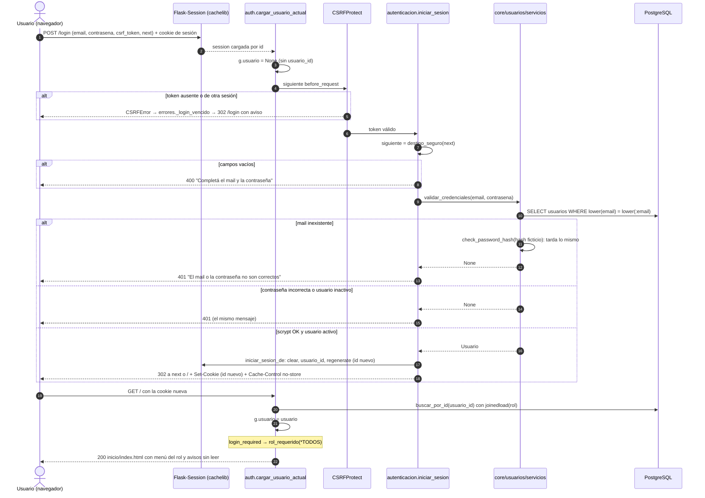

# Guía de estudio: la base del sistema (sprint 0)

## 1. Objetivo y cómo usar este documento

**Qué es.** La base del proyecto no es un escenario. Son las sesiones 2 a 7 de
[guia-agentes.md](../guia-agentes.md): estructura y configuración, base de datos, login y roles,
estudio y máquina de estados, notificaciones e integraciones, el módulo de referencia (E03 *Dar de
alta usuario*) y los tests con CI. Todo lo que escriban los demás issues se apoya en esto.

**Rama y números.**

| Dato | Valor |
|---|---|
| Rama | `base` (PR #22, mergeado a `development` el 16/11; todavía no está en `main`) |
| Comparación | `git log --oneline main..base` y `git diff --stat main...base` |
| Commits | 20 (de "Configuración del agente para el equipo" a "docs: guía de issues en PDF e issues creados (#3)") |
| Archivos | 122 nuevos, ninguno modificado ni borrado. +16 846 líneas |
| Código del sistema | `sistema/src`: 61 archivos, 3 816 líneas (incluye Bootstrap minificado) |
| Tests | `sistema/tests`: 30 archivos, 3 336 líneas. **561 tests, todos nuevos: 561 pasan, 0 fallan, 0 omitidos** (58,8 s) |
| Migraciones | 4 nuevas. Ya están aplicadas en Supabase (confirmado con el MCP de solo lectura) |
| CI | El check `pytest` del PR #22 terminó en verde |

**Cómo leerlo.** Las secciones 2 y 3 dan el mapa: qué archivos hay y qué regla cumple cada uno. La 4
recorre el código por pieza, en el orden en que cada una usa a la anterior. La 5 tiene dos
diagramas. La 7 es el plan de estudio con preguntas. La 8 tiene los comandos para reproducir todo.

**Criterio.** El código lo escribió un agente. En el coloquio hay que poder explicar cada decisión
sin mirar: por qué está, qué pasa si se saca y qué test lo detecta. Las preguntas de las secciones
7 y 9 apuntan a eso.

**Pendientes.**
- Pendiente de confirmar: que un compañero clone el repo y lo levante siguiendo solo `CLAUDE.md`
  (el último control de la guía). No se puede verificar desde el diff.
- No hay `docs/teoria/`: los pasos de estudio nombran el concepto teórico, sin número de diapositiva.
- `development` todavía no pasó a `main` (se hace antes del control del 17/11, decisión S16).

## 2. Mapa de los cambios

### Árbol (todo es NUEVO)

```text
TTPS-grupo10/
├── CLAUDE.md                         NUEVO  instrucciones del agente, comandos reales y "Cómo agregar un módulo"
├── .mcp.json                         NUEVO  MCP de Supabase en solo lectura, limitado al proyecto
├── .claude/settings.json             NUEVO  permisos allow/ask/deny (.env bloqueado, migraciones y push piden aprobación)
├── .claude/skills/…, agents/…        NUEVO  implementar-escenario, guia-estudio y el revisor-escenario
├── .github/workflows/tests.yml       NUEVO  ruff y pytest con Postgres 17 en cada PR
├── docs/                             NUEVO  lel.md, escenarios.md, modelo-datos.md, decisiones.md, apis/apigen.md, guías
├── scripts/crear_issues.ps1          NUEVO  carga de los issues en GitHub
└── sistema/
    ├── pyproject.toml, poetry.lock   NUEVO  dependencias (Flask, SQLAlchemy, Flask-SQLAlchemy-Lite, Flask-Session, Flask-WTF…)
    ├── .env.example                  NUEVO  todas las variables, sin valores secretos
    ├── app.py                        NUEVO  app = create_app()
    ├── supabase/migrations/          NUEVO  4 migraciones (inicial, estudios, notificaciones, e03_usuarios)
    ├── src/core/                     NUEVO  modelo: database, migraciones, usuarios, pacientes, estudios, notificaciones, provincias, paginación, seeds, demo
    ├── src/integraciones/            NUEVO  base (cliente común), apigen, mail, storage
    ├── src/web/                      NUEVO  create_app, config, errores, comandos, controllers, helpers, templates, static
    └── tests/                        NUEVO  conftest, fábricas, mocks de Apigen y 15 archivos de tests
```

### Tabla por archivo (código del sistema)

| Archivo | Capa | Cambio | Responsabilidad |
|---|---|---|---|
| `app.py` | Controlador | +5 | Punto de entrada de `flask run` |
| `src/web/__init__.py` | Controlador | +53 | `create_app()`: extensiones, blueprints, errores |
| `src/web/config.py` | Controlador | +120 | Configuración por entorno leída del `.env` |
| `src/web/errores.py` | Controlador | +42 | Páginas 403, 404, 500 y CSRF |
| `src/web/comandos.py` | Controlador | +82 | `flask seeds`, `flask demo`, `flask migrar-local` |
| `src/web/helpers/auth.py` | Controlador | +135 | `g.usuario`, `login_required`, `rol_requerido`, `no-store` |
| `src/web/helpers/csrf.py` | Controlador | +13 | `CSRFProtect` de Flask-WTF |
| `src/web/helpers/menu.py` | Controlador | +58 | `MENU_POR_ROL` y contador de avisos |
| `src/web/helpers/formato.py` | Controlador | +22 | Filtro `fecha_hora` en hora argentina |
| `src/web/controllers/autenticacion.py` | Controlador | +47 | `/login` y `/logout` |
| `src/web/controllers/inicio.py` | Controlador | +15 | `/` |
| `src/web/controllers/avisos.py` | Controlador | +32 | "Mis avisos" |
| `src/web/controllers/usuarios.py` | Controlador | +93 | E03: grilla y alta |
| `src/core/database.py` | Modelo | +58 | `db`, `Base`, `enum_de_texto` |
| `src/core/migraciones.py` | Modelo | +91 | Aplicar migraciones a una base local |
| `src/core/usuarios/*.py` | Modelo | +590 | Roles, usuarios, perfiles, credenciales, alta y búsqueda |
| `src/core/pacientes/modelos.py` | Modelo | +46 | Paciente mínimo de E06 |
| `src/core/estudios/*.py` | Modelo | +416 | 16 estados, 21 transiciones, `cambiar_estado()` |
| `src/core/notificaciones/*.py` | Modelo | +173 | `Aviso` y `notificar()` |
| `src/core/provincias/*.py` | Modelo | +42 | Las 24 jurisdicciones |
| `src/core/paginacion.py` | Modelo | +85 | `Pagina` y `paginar()` |
| `src/core/seeds.py`, `demo.py` | Modelo | +247 | Datos inventados de prueba |
| `src/integraciones/base.py` | Integración | +195 | `ClienteApi`: timeout, errores, mocks |
| `src/integraciones/apigen.py` | Integración | +232 | Cliente de Apigen (4 endpoints) |
| `src/integraciones/mail.py` | Integración | +82 | Flask-Mail con timeout de 5 s |
| `src/integraciones/storage.py` | Integración | +133 | Supabase Storage con mock en disco |
| `src/web/templates/**` | Vista | +579 | `layout.html`, login, errores, avisos, usuarios, macros |
| `src/web/static/js/formularios.js` | Vista | +76 | Validación en el cliente y campos según el rol |
| `supabase/migrations/*_inicial.sql` | Migración | +38 | `roles` y `usuarios` |
| `supabase/migrations/*_estudios.sql` | Migración | +142 | `medicos`, `pacientes`, `estudios`, `historial_estados`, `analisis`, `analisis_genes` |
| `supabase/migrations/*_notificaciones.sql` | Migración | +25 | `notificaciones` |
| `supabase/migrations/*_e03_usuarios.sql` | Migración | +55 | `provincias` y `transportistas` |
| `tests/conftest.py`, `fabricas.py` | Pruebas | +226 | Base de test, transacción por test, login por rol, fábricas |
| `tests/test_*.py` (15 archivos) | Pruebas | +3 087 | 561 tests |

**Migraciones.** Son 4 y todas nuevas. Ya figuran aplicadas en el proyecto de Supabase
`radpjgwkrzqtkczxcvxz` (`list_migrations` devuelve las cuatro versiones). Si se agrega una, la aplica
una persona con `npx supabase db push`; el agente tiene ese comando en `deny`.

## 3. Qué pide la base y dónde se cumple

Como no es un escenario, las reglas son los ítems de "Qué incluye la base" de la guía, más los
episodios de E03.

### Ítems de "Qué incluye la base"

| Regla | Origen | Dónde se cumple | Test que la verifica |
|---|---|---|---|
| Estructura de carpetas y `create_app()` con blueprints y errores 403, 404 y 500 | Guía, base 1 | `src/web/__init__.py:create_app`, `src/web/errores.py:registrar` | `test_app.py`: `test_ruta_inexistente_muestra_pagina_404`, `test_error_inesperado_muestra_pagina_500`; 403 en `test_acceso_con_el_rol_equivocado_devuelve_403` |
| Poetry con todas las dependencias | Guía, base 2 | `pyproject.toml`, `poetry.lock` | El CI corre `poetry install` en una máquina limpia (check `pytest` en verde) |
| `.env.example` con todas las variables | Guía, base 3 | `sistema/.env.example` (agrega `DATABASE_URL_LOCAL`, `SEEDS_CONTRASENA`, `URL_BASE`, `SUPABASE_BUCKET`, `APIGEN_GRUPO_ID`) | Sin test: revisión manual |
| Migración inicial con RLS en todas las tablas y sin políticas | Guía, base 4; S4 | Las 4 migraciones terminan con `enable row level security` | `test_base_de_datos.py::test_todas_las_tablas_tienen_rls` |
| El esquema sale solo de migraciones (sin `create_all`) | S4 | `src/core/database.py` (Lite no trae `create_all`), `src/core/migraciones.py` | `test_los_modelos_coinciden_con_las_migraciones` |
| Login y logout con Flask-Session y scrypt | Guía, base 5; S6 | `helpers/auth.py`, `controllers/autenticacion.py`, `usuarios/servicios.py:hashear_contrasena` | `test_autenticacion.py`: `test_login_correcto_…`, `test_la_contrasena_se_guarda_con_hash_scrypt`, `test_logout_cierra_la_sesion` |
| `login_required` y `rol_requerido` | Guía, base 5 | `helpers/auth.py` | `test_acceso_sin_sesion_redirige_al_login`, `test_acceso_con_el_rol_equivocado_devuelve_403`, `test_rol_requerido_rechaza_roles_que_no_estan_en_el_lel` |
| Un usuario de prueba por cada uno de los 7 roles del LEL | Guía, base 5; LEL *Usuario* | `src/core/seeds.py:USUARIOS_DE_PRUEBA`, `flask seeds` | `test_seeds.py::test_seeds_crea_un_usuario_por_cada_rol_del_lel`, `test_cada_usuario_de_prueba_inicia_sesion_y_ve_su_rol` |
| Todo POST lleva token CSRF | S6, `CLAUDE.md` | `helpers/csrf.py`, `<input name="csrf_token">` en cada form | `test_csrf.py` (8 tests), entre ellos `test_todos_los_formularios_post_llevan_el_token` |
| `layout.html` responsivo con Bootstrap local, menú según el rol y flash | Guía, base 6; S7 | `templates/layout.html`, `helpers/menu.py` | `test_inicio_muestra_el_layout_con_bootstrap_local`, `test_el_menu_cambia_segun_el_rol` |
| Modelo mínimo de Paciente con los datos de E06, sin pantallas | Guía, base 7 | `core/pacientes/modelos.py`, tabla `pacientes` | `test_pacientes.py` (4 tests) |
| Estudio con sus 16 estados | Guía, base 8; LEL *Estados del estudio* | `core/estudios/estados.py:EstadoEstudio`, dominio `estado_estudio` | `test_hay_un_estado_por_cada_estado_del_lel`, `test_la_base_rechaza_un_estado_desconocido` |
| `cambiar_estado()` solo permite las transiciones del LEL | Guía, base 8; S9 | `estados.py:TRANSICIONES` (21), `servicios.py:cambiar_estado` | `test_las_transiciones_son_las_21_del_lel`, 21 casos de `test_transicion_valida_del_lel`, 235 de `test_puede_pasar_rechaza_lo_que_el_lel_no_permite` |
| Cada cambio queda guardado con fecha y usuario | Guía, base 8; S9 | `HistorialEstado`, tabla `historial_estados` | `test_el_historial_guarda_todo_el_recorrido`, `test_el_sistema_cambia_el_estado_sin_usuario` |
| `notificar(usuario, asunto, mensaje, link)` guarda el aviso y manda el mail; en desarrollo por consola | Guía, base 9; S11; LEL *Notificación* | `core/notificaciones/servicios.py:notificar`, `integraciones/mail.py` | `test_notificar_guarda_el_aviso_y_manda_el_mail`, `test_si_el_mail_no_sale_el_aviso_se_guarda_igual` |
| "Mis avisos" en el layout | Sesión 6; E39 ep. 4 | `controllers/avisos.py`, `templates/avisos/listar.html` | `test_el_layout_muestra_mis_avisos_con_la_cantidad_sin_leer`, `test_abrir_un_aviso_de_otro_usuario_da_404` |
| Cliente base de APIs: timeout de 5 s, errores legibles y mock | Guía, base 10; S10 | `integraciones/base.py:ClienteApi` | `test_integraciones_base.py` (22 tests), `test_el_timeout_es_de_5_segundos` |
| Cliente de Apigen como primer ejemplo | Guía, base 10 | `integraciones/apigen.py` (endpoints 3, 4, 5 y 7 del contrato) | `test_apigen.py` (46 tests), `test_si_apigen_no_responde_cada_funcion_da_un_error_legible` |
| Módulo de referencia E03 completo | Guía, base 11 | Ver la tabla siguiente | `test_usuarios.py` (74 tests) |
| Tests de login, `cambiar_estado()` y E03, con fixtures por rol y base separada | Guía, base 12; S13 | `tests/conftest.py`: `base_de_test`, `app`, `login_como`; `tests/fabricas.py` | La suite completa: 561 pasan |
| GitHub Action con los tests en cada PR | Guía, base 13 | `.github/workflows/tests.yml` | Check `pytest` del PR #22 en verde |
| Archivos de la sección 4 y LEL y escenarios en `docs/` | Guía, base 14 | `CLAUDE.md`, `.claude/`, `docs/lel.md`, `docs/escenarios.md` | Sin test |

### E03 *Dar de alta usuario*

| Regla | Origen | Dónde se cumple | Test |
|---|---|---|---|
| Solo entra el administrador general | E03, precondición | `@rol_requerido(roles.ADMINISTRADOR_GENERAL)` en las 3 rutas de `controllers/usuarios.py` | `test_los_demas_roles_no_entran`, `test_sin_sesion_lleva_al_login`, `test_sin_sesion_no_se_puede_dar_de_alta` |
| Elige uno de 5 roles: médico tratante, gerente médico, administrativo, bioinformático o transportista | E03.1 | `roles.DE_ALTA_POR_ADMINISTRADOR`, `alta.py:validar_alta` | `test_el_formulario_ofrece_solo_los_cinco_roles_del_escenario`, `test_no_se_da_de_alta_con_un_rol_fuera_del_escenario` |
| Completa los datos que corresponden al rol | E03.2 | `validar_alta`: matrícula para médico y gerente; provincia para transportista | `test_medico_tratante_y_gerente_medico_se_dan_de_alta_con_matricula`, `test_transportista_se_da_de_alta_con_su_provincia`, `test_campos_vacios_muestran_un_error_en_cada_uno` |
| Matrícula única; un transportista por provincia | LEL *Transportista*; modelo de datos | Validación + índices únicos `medicos_matricula_key`, `transportistas_provincia_id_key` | `test_la_matricula_no_se_repite`, `test_hay_un_transportista_por_provincia`, `test_otra_alta_simultanea_con_la_misma_matricula_o_provincia` |
| Mail válido y único sin distinguir mayúsculas | Decisión del grupo; índice `usuarios_email_unico` | `PATRON_EMAIL`, `buscar_por_email` con `lower()` | `test_el_mail_tiene_que_ser_valido`, `test_el_mail_no_se_repite_aunque_cambien_las_mayusculas`, `test_otra_alta_simultanea_con_el_mismo_mail_da_error_de_validacion` |
| El sistema crea las credenciales de acceso | E03.3 | `dar_de_alta_usuario` + `generar_contrasena_provisoria` (12 caracteres, sin 0/O/1/l/I) | `test_la_contrasena_provisoria_es_aleatoria_y_facil_de_copiar`, `test_el_nuevo_usuario_inicia_sesion_con_la_contrasena_del_mail` |
| El sistema le manda las credenciales por mail | E03.4 | `enviar_credenciales` → `mail.enviar` | `test_el_mail_lleva_las_credenciales_y_el_link_de_ingreso` |
| Si el mail no sale, no se crea el usuario | Decisión S11 (16/11) | `controllers/usuarios.py:crear`: `rollback()` y 503 | `test_si_el_mail_no_sale_no_se_crea_el_usuario` |
| La contraseña no queda en `notificaciones` | Decisión S11 | No se usa `notificar()` | `test_la_contrasena_no_queda_en_los_avisos` |
| Grilla con búsqueda, filtro por rol, orden y paginación del lado del servidor | Prompt de la sesión 7 | `usuarios/busqueda.py`, `core/paginacion.py` | `test_busca_por_nombre_o_mail`, `test_filtra_por_rol`, `test_ordena_por_…`, `test_pagina_del_lado_del_servidor_y_los_links_conservan_la_busqueda` |
| Validación en el servidor y en el cliente | Prompt de la sesión 7 | `validar_alta` + `static/js/formularios.js` (`data-validar`) | `test_el_formulario_valida_tambien_en_el_cliente`, `test_con_errores_el_formulario_conserva_lo_escrito` |
| Los usuarios no se dan de baja ni modifican sus datos | E03, restricción | No hay rutas de edición ni de baja | Sin test (es una ausencia) |

**Cambios de estado del estudio.** La base no tiene pantallas que cambien estados. Deja la máquina
lista: las 21 transiciones del LEL, todas vía `cambiar_estado()`. Hoy la llaman `flask demo`
(`core/demo.py`), la fábrica `crear_estudio` de los tests y nadie más. `crear_estudio()` deja el
estudio en Creado con la primera fila del historial (anterior nulo).

**Roles con acceso.** `/login` es pública. `/`, `/logout`, `/avisos` y `/avisos/<id>/abrir` son de
los 7 roles. `/usuarios`, `/usuarios/nuevo` (GET y POST) son solo del administrador general.

**APIs externas.** Apigen (4 funciones), el servidor de mail y Supabase Storage. Ninguna pantalla
de la base llama a Apigen: el cliente queda listo para E10, E12 y E35.

### Reglas que no están en la especificación (las decidió el grupo o el agente)

- Mensaje único para mail inexistente, contraseña incorrecta y usuario inactivo, con un hash ficticio
  para que tarde lo mismo (S6).
- Id de sesión nuevo al iniciar sesión, vencimiento a las 8 h sin uso, `Cache-Control: no-store` (S6).
- `next` solo acepta rutas locales (`destino_seguro`).
- Un solo estudio por paciente (O20, `estudios.paciente_id` único).
- El código legible del estudio `EX-2026-00042` lo calcula la base.
- Las credenciales de E03 van por `mail.enviar()` y no por `notificar()` (S11).
- Las especialidades SNOMED y el cambio obligatorio de la contraseña provisoria quedan fuera (S17).

### Observaciones del LEL que la base resuelve

- **O9** (nombres de estados): se usan los 16 del LEL; `EstadoEstudio.nombre` da el texto.
- **O7** (inasistencia): la transición Turno sacado → Habilitado para turno existe; la puede
  disparar el sistema con `usuario=None`.
- **O20** (un estudio por paciente): restricción `unique` en la migración y control en `crear_estudio()`.
- **O10** (mail único): índice `usuarios_email_unico` sobre `lower(email)`.

## 4. Recorrido por pieza

### 4.1 Estructura y configuración

**`app.py` → `src/web/__init__.py:create_app(env)`.** Es una fábrica de aplicación. Carga el `.env`
con `load_dotenv()`, elige la configuración por `APP_ENV` y arranca las piezas en orden: base de
datos, sesión, `auth` (antes que CSRF, para que la página de error del token ya conozca al usuario),
CSRF, menú, filtros, comandos y mail. Después registra los 4 blueprints y los manejadores de error.

**`config.py`.** Cuatro clases. `Config` lee el entorno **en `__init__`**, no al importar: así los
tests cambian variables antes de crear la app.

| Clase | Qué cambia |
|---|---|
| `DevelopmentConfig` | `DEBUG`; usa `DATABASE_URL_LOCAL` si existe; suprime el envío de mail; `SECRET_KEY` y contraseña de seeds por defecto |
| `TestingConfig` | Usa `DATABASE_URL_TEST`; `USE_MOCKS=True`; sesiones en memoria (`SimpleCache`); **CSRF apagado** (lo prende `test_csrf.py`) |
| `ProductionConfig` | Cookie `Secure`; falla al arrancar si faltan `SECRET_KEY` o `DATABASE_URL` |

**`.env.example`.** Todas las variables, sin valores secretos. `.env` está en `deny` para el agente
(`.claude/settings.json`).

**`errores.py`.** Páginas propias para 403, 404, 500 y `CSRFError`. Caso especial: un login con el
token vencido (formulario viejo en otra pestaña) no muestra un 400: redirige con un aviso.

**`comandos.py`.** `flask seeds`, `flask demo <estado>` y `flask migrar-local`. Este último se niega
si la URL es de Supabase o es la misma que `DATABASE_URL` (`migraciones.motivo_para_no_borrar`).

### 4.2 Base de datos y migraciones

**`core/database.py`.** Usa Flask-SQLAlchemy-Lite, que **no es** Flask-SQLAlchemy: no trae
`db.Model` ni `create_all`, solo engines y sesiones. Los modelos heredan de `Base`, que es
SQLAlchemy puro.

| Función | Qué hace |
|---|---|
| `Base` | Clase base declarativa de todos los modelos |
| `enum_de_texto(enum)` | Columna `text` que guarda el valor del `StrEnum` (`"creado"`) y devuelve el miembro. No crea check propio: lo pone la migración |
| `db = SQLAlchemy(engine_options={"pool_pre_ping": True})` | Descarta conexiones que el pooler de Supabase cerró |
| `url_de_conexion(url)` | Fuerza el driver `psycopg` 3 aunque la URL venga como `postgresql://` |
| `init_app(app)` | Falla con un mensaje claro si falta la URL |

**Migraciones.** Cuatro archivos SQL en orden de fecha. Ideas clave:
- `usuarios_email_unico` es un índice único sobre `lower(email)`.
- `estado_estudio` es un *domain* con un `check` de los 16 valores. La lista tiene que coincidir con
  `EstadoEstudio`.
- `historial_estados_primera_fila`: solo la fila de Creado tiene `estado_anterior` nulo.
- `estudios.codigo` es una columna generada (`EX-<año>-<id>`); en el modelo va con `FetchedValue()`.
- `analisis_uno_abierto_por_estudio`: índice único parcial (`where finalizado_en is null`).
- **RLS activado y sin políticas** en todas las tablas. La app se conecta como dueña de las tablas
  y RLS no la afecta. La API pública de Supabase (`anon`, `authenticated`) no ve nada.

**`core/migraciones.py`.** Aplica las migraciones a una base **local**: borra el esquema `public` y
ejecuta cada `.sql` en orden, todo en **una transacción** (si una falla, no queda nada a medias).
Usa `no_parameters` para que psycopg acepte varios statements y no interprete los `%`.

**Base de test (`tests/conftest.py`).**
- `base_de_test` (una vez por corrida): crea la base si falta y aplica las migraciones. Se niega a
  correr si `DATABASE_URL_TEST` apunta a Supabase o a la base compartida.
- `app` (por test): abre una conexión, empieza una transacción externa y configura las sesiones con
  `join_transaction_mode="create_savepoint"`. El `commit()` del código solo libera un savepoint. Al
  terminar, `rollback()` de la transacción externa: el test no deja nada. El comentario explica por
  qué no se usa `db.test_isolation()` de Lite 0.2.1 con SQLAlchemy 2.1.

### 4.3 Login y roles

**`core/usuarios/servicios.py`.**

| Función | Qué hace |
|---|---|
| `hashear_contrasena` | `generate_password_hash(…, method="scrypt")` de Werkzeug |
| `buscar_por_email` | Compara con `lower()`, igual que el índice |
| `buscar_por_id` | Trae el rol con `joinedload` (el layout lo muestra siempre) |
| `validar_credenciales` | Devuelve el usuario o `None`, sin distinguir el motivo. Si el mail no existe, igual verifica contra un hash ficticio para que la respuesta tarde lo mismo |
| `crear_usuario`, `crear_perfil_medico` | Agregan a la sesión. No hacen commit |

**`web/helpers/auth.py`.**

| Función | Qué hace |
|---|---|
| `cargar_usuario_actual` (`before_request`) | Pone en `g.usuario` el usuario de `session["usuario_id"]`. Si fue borrado o desactivado, limpia la sesión |
| `no_guardar_en_el_navegador` (`after_request`) | `Cache-Control: no-store` salvo en `static` |
| `iniciar_sesion_de` | `session.clear()`, guarda el id y **regenera** el id de sesión (contra fijación de sesión) |
| `login_required` | Sin usuario → redirige a `/login?next=…` (solo si era GET) |
| `rol_requerido(*codigos)` | Valida al decorar que los roles existan. Sin usuario → login; rol equivocado → `abort(403)` |
| `destino_seguro` | Acepta `next` solo si es una ruta local: evita la redirección abierta |

**Rutas.**

| Método | Ruta | Endpoint | Rol |
|---|---|---|---|
| GET, POST | `/login` | `autenticacion.iniciar_sesion` | Pública |
| POST | `/logout` | `autenticacion.cerrar_sesion` | Los 7 |
| GET | `/` | `inicio.index` | Los 7 |

**Flask-Session.** La sesión vive en el servidor (`cachelib`, un archivo por sesión en
`instance/sesiones`). La cookie solo lleva el id. Vence a las 8 h sin uso. Cookie `HttpOnly`,
`SameSite=Lax` y, en producción, `Secure`.

**CSRF (`helpers/csrf.py`).** `CSRFProtect` exige el token en todo POST, PUT, PATCH o DELETE. El
token vive en la sesión y vence con ella (`WTF_CSRF_TIME_LIMIT = None`). Logout es POST con token:
otro sitio no puede cerrarte la sesión.

**Menú (`helpers/menu.py`).** `MENU_POR_ROL` tiene una entrada por rol; hoy solo el administrador
general tiene "Usuarios". El `context_processor` agrega `menu` y `avisos_sin_leer` a todas las
plantillas. Si la base falla al contar avisos, muestra 0 en vez de romper la página de error.

### 4.4 Estudio y máquina de estados

**`core/estudios/estados.py`** no usa Flask ni la base.

| Elemento | Qué es |
|---|---|
| `EstadoEstudio(StrEnum)` | Los 16 estados. El valor es el código de la base; `.nombre` es el texto del LEL |
| `_TRANSICIONES` | Origen → {destino: impacto del LEL}. 21 pares |
| `TRANSICIONES` | La misma tabla envuelta en `MappingProxyType`: de solo lectura |
| `puede_pasar(origen, destino)` | `True` si el par está en la tabla |
| `TransicionInvalida` | Excepción para un paso no permitido |

**`core/estudios/modelos.py`.** `Estudio`, `HistorialEstado`, `Analisis` y `AnalisisGen`. El
historial se ordena por `(creado_en, id)` porque `now()` da la misma hora a todo lo de una transacción.

**`core/estudios/servicios.py`.**

| Función | Qué hace |
|---|---|
| `crear_estudio(paciente, medico_tratante, genes, …)` | Valida (rol médico tratante, matrícula, sin estudio previo, al menos un gen). Crea el estudio en Creado, el análisis inicial con sus genes y la primera fila del historial. Hace `flush()` para tener id y código |
| `cambiar_estado(estudio, nuevo_estado, usuario, motivo=None)` | Ver los pasos abajo |

Pasos de `cambiar_estado()`:
1. Convierte `nuevo_estado` en `EstadoEstudio`. Si no existe → `TransicionInvalida`.
2. `db.session.flush()`: escribe cambios pendientes, porque el paso 3 los descartaría.
3. `db.session.refresh(estudio, ["estado"], with_for_update=True)`: relee el estado con
   `SELECT … FOR UPDATE`. La fila queda bloqueada hasta el commit. Un segundo pedido concurrente
   espera y decide con el estado nuevo, no con uno viejo.
4. Si `puede_pasar(origen, destino)` es falso → `TransicionInvalida` y no cambia nada.
5. Asigna el estado y agrega un `HistorialEstado` con anterior, nuevo, usuario (o `None` si es el
   sistema) y motivo.
6. **No hace commit** y **no controla el rol**: la misma transición la provocan actores distintos;
   el rol lo controlan la ruta y la función del escenario.

**Dos defensas en la base.** Aunque alguien saltee `cambiar_estado()`, el *domain* rechaza un
estado desconocido y el `check` del historial rechaza una fila sin anterior que no sea Creado.

**`core/demo.py`.** `camino_desde_creado(destino)` hace una búsqueda en anchura (BFS) sobre
`TRANSICIONES`. `flask demo` y la fábrica `crear_estudio` la usan para llevar un estudio a cualquier
estado pasando siempre por `cambiar_estado()`. `DATOS_POR_ESTADO` es el registro donde cada issue
agrega las filas que su estado necesita.

### 4.5 Notificaciones e integraciones

**`core/notificaciones/servicios.py`.**

| Función | Qué hace |
|---|---|
| `notificar(usuario, asunto, mensaje, link, estudio=None)` | Valida asunto, mensaje y que `link` sea una ruta local. Guarda el `Aviso`, hace `flush()` y manda el mail. Si el mail sale, completa `mail_enviado_en`; si no, el aviso queda igual |
| `avisos_de(usuario, pagina)` | Paginados, los más nuevos primero |
| `contar_sin_leer`, `marcar_leido` | Badge del layout y "abrir" un aviso. `marcar_leido` devuelve `None` si es de otro usuario |

Ojo: el mail sale **antes** del commit de quien llama. Si después hay rollback, el mail ya salió
(lo dice el docstring).

**Rutas de avisos.**

| Método | Ruta | Endpoint | Rol |
|---|---|---|---|
| GET | `/avisos` | `avisos.listar` | Los 7 |
| POST | `/avisos/<id>/abrir` | `avisos.abrir` | Los 7 (404 si el aviso es de otro: no revela que existe) |

**`integraciones/mail.py`.** Flask-Mail 0.10 abre `smtplib.SMTP` sin timeout. El módulo lo subclasea
(`_ConexionConTimeout`) para usar 5 s. `enviar()` nunca lanza: devuelve `False` y deja el error en el
log. Con `MAIL_SUPPRESS_SEND` (desarrollo y tests) el mail se muestra por consola.

**`integraciones/base.py:ClienteApi`.**

| Caso | Resultado |
|---|---|
| `usar_mocks` | Lee `tests/fixtures/apis/<api>/<clave>.json`; si existe `<clave>.error.json`, simula ese error. Acepta varias claves y usa la primera con archivo |
| Timeout (5 s) | `ErrorDeIntegracion("… no respondió a tiempo…")` |
| Sin conexión | `ErrorDeIntegracion("No se pudo conectar…")` |
| 401/403 | "rechazó la clave de acceso" (sin detalle técnico) |
| ≥ 500 | "tuvo un error interno" |
| 400 con `message` | El texto de la API ("Patología inexistente: …") |
| No es JSON | `formato_inesperado()` |

`_nombre_de_archivo` reemplaza todo lo que no sea letra, número, `_` o `-`: una clave no puede
salirse de la carpeta de mocks. `transport=` permite inyectar un `httpx.MockTransport` en los tests.

**`integraciones/apigen.py`.** Cuatro funciones del contrato (endpoints 3, 4, 5 y 7):
`genes_de_patologia`, `genes_hallazgos_secundarios`, `variantes_de_gen` y `resultado_diagnostico`.
La clave va en el header `apikey`. Cada una valida la forma de la respuesta y, si no es la del
contrato, lanza `formato_inesperado()`. `variantes_de_gen` lee el total del header `Content-Range`.

**`integraciones/storage.py`.** `subir` y `bajar` del bucket privado. Valida la ruta con una regex
(sin `..`, sin rutas absolutas). Con mocks guarda en `instance/storage/`.

### 4.6 Módulo de referencia E03

**Core (`core/usuarios/alta.py`).**

| Elemento | Qué hace |
|---|---|
| `DatosDeAlta.desde(request.form)` | Dataclass inmutable con los campos como texto, sin espacios en los bordes |
| `validar_alta(datos)` | Devuelve `{campo: mensaje}`. Ignora los campos que no corresponden al rol |
| `dar_de_alta_usuario(datos)` | Valida; genera la contraseña; dentro de `begin_nested()` (savepoint) crea usuario y perfil y hace `flush()`. Si un índice único choca (alta simultánea), traduce el nombre de la restricción a un campo y lanza `ErrorDeValidacion` |
| `enviar_credenciales(usuario, contrasena, link)` | Arma el mail con usuario, contraseña y link absoluto al login |
| `generar_contrasena_provisoria()` | 12 caracteres con `secrets`, al menos una letra y un número, sin 0/O/1/l/I |

**Core (`core/usuarios/busqueda.py` y `core/paginacion.py`).**
- `BusquedaDeUsuarios.desde(request.args)` normaliza la URL: un rol o columna desconocidos vuelven al
  valor por defecto en vez de dar error.
- `buscar_usuarios` agrega un `where` por palabra con `icontains(…, autoescape=True)`: `%` y `_` se
  buscan tal cual y no hay SQL armado con strings. El orden termina en `Usuario.id` para desempatar.
- `paginar` cuenta con una subconsulta sin `order by`, ajusta la página al rango válido y trae solo
  esa página con `limit`/`offset`.

**Controlador (`web/controllers/usuarios.py`).**

| Método | Ruta | Endpoint | Rol |
|---|---|---|---|
| GET | `/usuarios` | `usuarios.listar` | Administrador general |
| GET | `/usuarios/nuevo` | `usuarios.nuevo` | Administrador general |
| POST | `/usuarios/nuevo` | `usuarios.crear` | Administrador general |

`crear()` sigue este orden: `dar_de_alta_usuario` → si hay errores, 400 con el formulario →
`enviar_credenciales` → si el mail falla, **`rollback()`** y 503 → si sale, **`commit()`** y
redirect a la grilla (PRG: Post/Redirect/Get). El controlador decide el commit; core nunca lo hace.

**Vistas.** `usuarios/listar.html` usa un form **GET** (la búsqueda queda en la URL), cabeceras con
`aria-sort` y la macro de paginación. `usuarios/nuevo.html` usa las macros de
`macros/formularios.html`, que pintan los errores del servidor debajo de cada campo.
`static/js/formularios.js` valida antes de enviar, muestra la matrícula o la provincia según el rol
(`data-segun`) y deshabilita el botón tras el envío para evitar el doble alta.

### 4.7 Tests y CI

| Archivo | Tests | Qué cubre |
|---|---|---|
| `test_estados_estudio.py` | 296 | 16 estados, las 21 transiciones válidas, los 235 pares inválidos, concurrencia, historial y checks de la base |
| `test_usuarios.py` | 74 | E03: alta por rol, validaciones, altas simultáneas, mail, grilla y accesos |
| `test_apigen.py` | 46 | Cada función con mocks y con `MockTransport`, errores y formato |
| `test_autenticacion.py` | 34 | Login, logout, roles, `next`, `no-store`, menú |
| `test_integraciones_base.py` | 22 | Timeout, errores HTTP, mocks |
| `test_notificaciones.py` | 20 | `notificar()` y "Mis avisos" |
| `test_storage.py` | 20 | Subir, bajar, rutas inválidas, fallas |
| `test_demo.py` | 14 | `flask demo` y `flask migrar-local` |
| `test_csrf.py` | 8 | Token en login, logout, header y en todos los forms |
| `test_seeds.py` | 6 | Un usuario por rol, idempotencia |
| `test_estudios.py` | 6 | Reglas de `crear_estudio()` |
| `test_base_de_datos.py` | 5 | RLS en todas las tablas, modelos = migraciones |
| `test_app.py`, `test_pacientes.py` | 4 + 4 | Layout, 404, 500; paciente |
| `test_mail.py` | 2 | Timeout SMTP |

Las listas del LEL en `test_estados_estudio.py` están escritas a mano a propósito: si alguien
agrega o quita una transición en el código, el test lo detecta.

**Fábricas (`tests/fabricas.py`).** `crear_usuario(rol)` (con login real), `usuario_rapido(rol)`
(hash ficticio, sin scrypt, más rápido), `crear_paciente`, `crear_estudio(estado=…)`.
`login_como(rol)` en `conftest.py` crea el usuario y loguea el cliente.

**CI (`.github/workflows/tests.yml`).** En cada PR y en cada push a `main` y `development`:
Postgres 17 como servicio (la versión de Supabase), Poetry, `ruff check` y `pytest`. Un push nuevo
cancela la corrida anterior del mismo PR.

## 5. Flujos de punta a punta

### 5.1 Request de login



Los rechazos posibles son tres: token CSRF inválido, campos vacíos y credenciales incorrectas. Un
usuario ya logueado que abre `/login` va directo a `next` o a `/`.

### 5.2 Cambio de estado de un estudio

En la base todavía no hay una pantalla que cambie estados. El diagrama muestra el caso que va a
tener cada escenario, por ejemplo el administrativo que emite el presupuesto (Creado → Presupuestado).

```mermaid
sequenceDiagram
    autonumber
    actor A as Administrativo
    participant R as Ruta del escenario (controlador)
    participant F as Función de core del escenario
    participant CE as estudios.cambiar_estado
    participant T as estados.puede_pasar
    participant DB as PostgreSQL
    participant N as notificar()

    A->>R: POST con csrf_token
    R->>R: @login_required · @rol_requerido(ADMINISTRATIVO)
    alt sin sesión o rol equivocado
        R-->>A: 302 /login o 403
    end
    R->>F: regla de negocio del escenario
    F->>CE: cambiar_estado(estudio, PRESUPUESTADO, usuario, motivo)
    CE->>CE: EstadoEstudio(nuevo) — si no existe, TransicionInvalida
    CE->>DB: flush() de cambios pendientes
    CE->>DB: SELECT estado FROM estudios WHERE id=… FOR UPDATE
    Note over DB: fila bloqueada hasta el commit; otro pedido espera
    DB-->>CE: estado actual real (no el de memoria)
    CE->>T: puede_pasar(origen, destino)
    alt el LEL no lo permite
        T-->>CE: False
        CE-->>F: TransicionInvalida
        F-->>R: excepción
        R->>DB: rollback()
        R-->>A: flash del error
    end
    T-->>CE: True
    CE->>DB: estudio.estado = destino; INSERT historial_estados (anterior, nuevo, usuario, motivo)
    CE-->>F: HistorialEstado
    F->>N: notificar(paciente, …) (si el escenario lo pide)
    N->>DB: INSERT notificaciones; el mail sale en este momento
    F-->>R: ok
    R->>DB: commit() — libera el bloqueo
    R-->>A: 302 (PRG)
```

Si alguien intenta escribir el estado por fuera de `cambiar_estado()`, la base todavía rechaza un
valor fuera de los 16 (domain) y una fila de historial sin estado anterior que no sea Creado (check).

## 6. Decisiones de diseño y observaciones

**Decisiones a validar con el grupo.**
- Core nunca hace commit; lo decide el controlador. Es la regla que más cuesta respetar en los
  escenarios que encadenan varias funciones de core.
- `cambiar_estado()` no controla roles. Cada escenario tiene que poner `@rol_requerido` y, si hace
  falta, chequear en core quién dispara el cambio.
- `notificar()` manda el mail antes del commit. Si un escenario hace rollback después de notificar,
  el destinatario recibe un mail de algo que no quedó guardado. Conviene notificar al final.
- Las sesiones se guardan en archivos de `instance/sesiones`. Sirve para un solo servidor; con varios,
  habría que cambiar el backend de cachelib.
- En `TestingConfig` el CSRF está apagado. Los tests de escenario no prueban el token; lo prueba
  solo `test_csrf.py` (incluido el que revisa que todo form POST tenga el campo).

**Supuestos del LEL adoptados.** O7, O9, O10 y O20 (sección 3). El resto de las observaciones
(O1–O6, O8, O11–O19) quedan para sus escenarios.

**Bugs encontrados al implementar (según los commits y comentarios).**
- `db.test_isolation()` de Flask-SQLAlchemy-Lite 0.2.1 con SQLAlchemy 2.1 confirmaba la transacción
  externa y el test siguiente fallaba con `RecursionError`. Se reemplazó por la receta
  "Joining a Session into an External Transaction" (`conftest.py`).
- Flask-Mail 0.10 no tiene timeout SMTP: un servidor colgado bloqueaba el alta de E03 (`mail.py`).
- El botón Atrás mostraba páginas guardadas tras el logout y el login con token vencido daba 400
  (commit `499e4e1`): se agregó `no-store` y `_login_vencido`.

**No implementado y por qué.**
- Registro (E01, E02), código por dispositivo nuevo (parte de E04), activación del paciente (E05):
  fuera de la base por la guía.
- Especialidades SNOMED de los médicos y cambio obligatorio de la contraseña provisoria (S17).
- Pantallas de pacientes y estudios: la base solo deja los modelos.
- `apscheduler`, `xhtml2pdf` y `openpyxl` están instalados pero no se usan todavía.

**Fuera de alcance visto al revisar.**
- **Falta el `mantener-activo` del sistema.** La guía ("Supabase", paso 5) pide copiar ese workflow
  para el proyecto nuevo. En `main` existe `.github/workflows/mantener-activo.yml`, pero solo consulta
  el proyecto de Apigen, y la rama `base` no lo toca. El proyecto del sistema
  (`radpjgwkrzqtkczxcvxz`) no tiene quién lo mantenga activo: si Supabase lo pausa por inactividad,
  la app se queda sin base. No es un ítem de la lista "Qué incluye la base", pero conviene un issue.

## 7. Guía de estudio paso a paso

### Paso 1 · Estructura y configuración

- **Leer:** patrón MVC y *application factory*; configuración por entorno (12-factor). Decisiones
  S1, S8 y S15 de `docs/decisiones.md`.
- **Recorrer:** `app.py` → `src/web/__init__.py:create_app` → `src/web/config.py` (las 4 clases)
  → `sistema/.env.example` → `src/web/errores.py`.
- **Explicar:**
  1. ¿Por qué `Config` lee el entorno en `__init__` y no como atributos de clase?
  2. ¿Qué pasa si arrancás en producción sin `SECRET_KEY`? ¿Y en desarrollo?
  3. ¿Por qué `auth.init_app` va antes que `csrf.init_app`?
  4. ¿Qué devuelve un POST a `/login` con el token vencido, y por qué no es un 400?

### Paso 2 · Base de datos y migraciones

- **Leer:** ORM y unidad de trabajo (sesión, flush, commit); transacciones y savepoints; Row Level
  Security de PostgreSQL. Decisiones S3, S4 y S5.
- **Recorrer:** `core/database.py` → las 4 migraciones en orden → `core/migraciones.py` →
  `tests/conftest.py` (`base_de_test`, `app`) → `test_base_de_datos.py`.
- **Explicar:**
  1. ¿Qué diferencia hay entre Flask-SQLAlchemy-Lite y Flask-SQLAlchemy, y por qué no hay `create_all`?
  2. Si RLS está activado y no hay políticas, ¿cómo lee la app? ¿Quién no puede leer?
  3. ¿Cómo logra el fixture `app` que un `commit()` del código no deje datos en la base de test?
  4. ¿Qué test falla si agregás una columna al modelo y te olvidás de la migración?

### Paso 3 · Login y roles

- **Leer:** sesión del lado del servidor, hash de contraseñas (scrypt), fijación de sesión,
  redirección abierta, CSRF y enumeración de usuarios. Decisión S6; E04; LEL *Usuario*.
- **Recorrer:** `core/usuarios/roles.py` → `modelos.py` → `servicios.py` (`validar_credenciales`)
  → `web/helpers/auth.py` → `controllers/autenticacion.py` → `helpers/csrf.py` → `helpers/menu.py`
  → `templates/layout.html`.
- **Explicar:**
  1. ¿Por qué se verifica un hash ficticio cuando el mail no existe?
  2. ¿Qué ataque evita `regenerate(session)` y por qué va después de guardar el `usuario_id`?
  3. ¿Qué pasa si invertís el orden de `@login_required` y `@rol_requerido`?
  4. ¿Por qué `/logout` es POST y no GET?

### Paso 4 · Estudio y máquina de estados

- **Leer:** máquinas de estado finitas; bloqueo pesimista (`SELECT … FOR UPDATE`); LEL, sección
  *Estados del estudio*; decisión S9; observaciones O7, O9 y O20.
- **Recorrer:** `core/estudios/estados.py` → `modelos.py` → `servicios.py` (`crear_estudio`,
  `cambiar_estado`) → migración `estudios.sql` (domain y checks) → `core/demo.py:camino_desde_creado`
  → `test_estados_estudio.py`.
- **Explicar:**
  1. ¿Qué problema resuelve el `refresh(…, with_for_update=True)`? ¿Qué test lo prueba y cómo simula
     el otro pedido?
  2. ¿Por qué hay un `flush()` antes del `refresh`?
  3. ¿Por qué `cambiar_estado()` no controla el rol del usuario?
  4. Si alguien hace `estudio.estado = "pagado"` a mano y commitea, ¿qué lo frena?

### Paso 5 · Notificaciones e integraciones

- **Leer:** integración con servicios externos (timeouts, fallas, *test doubles*); LEL
  *Notificación*; decisiones S10 y S11; `apigen/contrato.md`.
- **Recorrer:** `core/notificaciones/servicios.py` → `integraciones/mail.py` →
  `integraciones/base.py` → `integraciones/apigen.py` → `tests/fixtures/apis/apigen/` →
  `controllers/avisos.py` → `test_integraciones_base.py`.
- **Explicar:**
  1. ¿Qué pasa con el aviso si el servidor de mail está caído? ¿Y con el escenario que notificó?
  2. ¿Qué ve el usuario si Apigen tarda 10 s? Seguí el camino desde `httpx` hasta el `flash`.
  3. ¿Cómo se simula con mocks que MPS2 no existe en Apigen?
  4. ¿Por qué abrir un aviso de otro usuario da 404 y no 403?

### Paso 6 · Módulo de referencia E03

- **Leer:** E03 en `docs/escenarios.md`; decisión S17; patrón PRG; validación en cliente y servidor;
  "Cómo agregar un módulo" en `CLAUDE.md`.
- **Recorrer:** `core/usuarios/alta.py` → `busqueda.py` → `core/paginacion.py` →
  `controllers/usuarios.py` → `templates/usuarios/listar.html` y `nuevo.html` →
  `macros/formularios.html` → `static/js/formularios.js` → migración `e03_usuarios.sql`.
- **Explicar:**
  1. ¿Por qué el mail sale antes del commit y qué pasa si falla?
  2. Dos administradores dan de alta el mismo mail a la vez y ambos pasan la validación. ¿Qué
     hace `begin_nested()` y cómo llega el error al campo correcto?
  3. ¿Por qué la búsqueda usa `icontains(…, autoescape=True)` y el orden termina en `Usuario.id`?
  4. ¿Por qué no se usa `notificar()` para mandar las credenciales?

### Paso 7 · Tests y CI

- **Leer:** pruebas automatizadas como evals del agente; aislamiento de tests; integración continua.
  Decisión S13.
- **Recorrer:** `tests/conftest.py` → `tests/fabricas.py` → `test_estados_estudio.py` (listas a
  mano y parametrize) → `test_csrf.py::test_todos_los_formularios_post_llevan_el_token` →
  `.github/workflows/tests.yml`.
- **Explicar:**
  1. ¿Por qué las transiciones del LEL están escritas a mano en el test y no importadas?
  2. ¿Qué diferencia hay entre `crear_usuario` y `usuario_rapido`, y cuándo usar cada una?
  3. ¿Qué hace el CI antes de `pytest`, y contra qué base corre?

### Ejercicio sin mirar el código

Escribí, capa por capa, qué pasa cuando el administrador general da de alta a un transportista de
Jujuy: desde que elige el rol en el formulario (vista y JS) hasta que el transportista inicia sesión
con la contraseña del mail. Nombrá: decoradores, token CSRF, `DatosDeAlta`, `validar_alta`,
savepoint, índices únicos, `enviar_credenciales`, rollback o commit, redirect, y qué tablas quedan
con filas nuevas. Después hacé lo mismo para el estudio que pasa de Creado a Presupuestado.

## 8. Comandos para reproducir y verificar (PowerShell)

Desde la raíz del repo:

```powershell
git fetch origin
git log --oneline main..origin/base
git diff --stat main...origin/base
```

Instalar y correr los tests (desde `sistema/`; necesita un Postgres local y `DATABASE_URL_TEST` en
`.env`):

```powershell
cd sistema
poetry install
poetry run ruff check src tests
poetry run pytest -q
```

Resultado esperado: `561 passed` (alrededor de 1 minuto).

Migraciones: las 4 ya están aplicadas en Supabase. Una nueva la aplica una persona:

```powershell
npx supabase db push
```

Probar a mano sin tocar Supabase:

```powershell
poetry run flask migrar-local
poetry run flask seeds
poetry run flask demo habilitado_turno
poetry run flask run --debug
```

1. Abrí `http://localhost:5000/usuarios`: te lleva al login con `next`.
2. Entrá con `admin@exoma.test` y la contraseña de `SEEDS_CONTRASENA` (en desarrollo, si está vacía,
   `prueba1234`). Vuelve a `/usuarios`.
3. "Dar de alta usuario" → Transportista → la matrícula se oculta y aparece la provincia. Buenos
   Aires figura como "ya tiene transportista".
4. Completá con un mail nuevo y enviá. En la consola de `flask run` aparece el mail con la
   contraseña provisoria (`MAIL_SUPPRESS_SEND`).
5. Cerrá sesión y entrá con el usuario nuevo: ve solo "Inicio" y "Mis avisos". `/usuarios` da 403.
6. Probalo también en el celular o con la vista responsiva del navegador.

### Mutaciones

Cada una rompe una regla a propósito, corre toda la suite y restaura con `git restore`.

| # | Pieza | Mutación | Tests que fallan | Resultado |
|---|---|---|---|---|
| M1 | Login y roles | `helpers/auth.py`: en `rol_requerido`, `abort(403)` → `pass` | `test_acceso_con_el_rol_equivocado_devuelve_403` (6 roles) y `test_los_demas_roles_no_entran` (6 roles) | 12 fallan, 549 pasan |
| M2 | Máquina de estados | `estados.py`: agregar Creado → Habilitado para turno | `test_las_transiciones_son_las_21_del_lel`, `test_puede_pasar_rechaza_…[creado->habilitado_turno]`, `test_transicion_invalida_no_cambia_nada[saltea el presupuesto]`, `test_el_historial_guarda_todo_el_recorrido`, `test_demo_habilitado_turno_crea_…` | 5 fallan, 556 pasan |
| M3 | Máquina de estados | `servicios.py`: borrar el `refresh(…, with_for_update=True)` | `test_decide_con_el_estado_de_la_base_y_no_con_uno_viejo` | 1 falla, 560 pasan |
| M4 | Integraciones | `base.py`: `TIMEOUT_EN_SEGUNDOS = 30.0` | `test_el_timeout_es_de_5_segundos`, `test_sin_mock_sube_al_bucket_con_timeout_de_5_segundos` | 2 fallan, 559 pasan |
| M5 | E03 | `controllers/usuarios.py`: si el mail falla, `commit()` en vez de `rollback()` | `test_si_el_mail_no_sale_no_se_crea_el_usuario` | 1 falla, 560 pasan |

Qué enseñan:
- **M2** rompe más de lo esperado. Con el atajo, el camino más corto a Habilitado para turno (BFS de
  `camino_desde_creado`) ya no pasa por Presupuestado. Por eso fallan también el historial y `flask demo`.
- **M3** la detecta un solo test. Es el único que simula dos pedidos a la vez: si se borra, se pierde
  la protección contra la condición de carrera.
- **M4**: `test_mail.py` **no** falla, porque compara contra la misma constante
  `TIMEOUT_EN_SEGUNDOS`. Los que fallan escriben el 5 a mano.

Para repetir una (ejemplo M3), desde `sistema/`:

```powershell
# Borrá a mano la línea del refresh en src/core/estudios/servicios.py y después:
poetry run pytest tests/test_estados_estudio.py -q
git restore src/core/estudios/servicios.py
git status
```

## 9. Glosario y autoevaluación

| Término | Significado en este proyecto | Dónde verlo |
|---|---|---|
| Estudio | Exoma clínico de un paciente; uno por paciente (O20) | `core/estudios/modelos.py:Estudio` |
| Estado del estudio | Uno de los 16 del LEL | `estados.py:EstadoEstudio` |
| Transición | Paso permitido entre dos estados, ligado a un impacto del LEL | `estados.py:TRANSICIONES` |
| Historial de estados | Una fila por cambio, con fecha, usuario y motivo | tabla `historial_estados` |
| Notificación / aviso | Mail + fila en la lista de pendientes | `notificar()`, tabla `notificaciones` |
| Credenciales de acceso | Mail y contraseña; en E03 la contraseña es provisoria | `alta.py:enviar_credenciales` |
| Administrador general | Rol que da de alta a los demás usuarios internos | `roles.ADMINISTRADOR_GENERAL` |
| Transportista | Rol con una provincia; uno por provincia | tabla `transportistas` |
| `g.usuario` | El usuario logueado durante el request | `helpers/auth.py` |
| Flask-Session | Sesión guardada en el servidor; la cookie lleva solo el id | `config.py`, `__init__.py:_init_sesion` |
| scrypt | Función de hash lenta para contraseñas | `servicios.py:hashear_contrasena` |
| CSRF | Ataque que usa la sesión del usuario desde otro sitio; se frena con un token | `helpers/csrf.py` |
| RLS | Row Level Security: sin políticas, la API pública de Supabase no ve filas | migraciones |
| Flush | Escribe en la base sin confirmar la transacción | `crear_estudio`, `notificar` |
| Savepoint | Punto dentro de una transacción al que se puede volver | `begin_nested()` en `alta.py`; `conftest.py` |
| `FOR UPDATE` | Bloqueo de la fila hasta el commit | `cambiar_estado()` |
| Mock | Respuesta simulada de una API leída de un archivo | `tests/fixtures/apis/` |
| `ErrorDeIntegracion` | Falla de una API externa con un mensaje para mostrar | `integraciones/base.py` |
| PRG | Post/Redirect/Get: tras un POST exitoso se redirige | `controllers/usuarios.py:crear` |
| Fábrica (test) | Fixture que crea datos con valores por defecto | `tests/fabricas.py` |

### Autoevaluación

1. ¿Qué tres cosas hace `create_app()` antes de registrar los blueprints, y por qué importa el orden
   de `auth` y `csrf`? (Paso 1)
2. ¿Qué pasa si `DATABASE_URL_TEST` apunta a Supabase? ¿Dónde se controla? (Paso 2)
3. ¿Cómo comprueba un test que todas las tablas tienen RLS? (Paso 2)
4. ¿Por qué un mail inexistente y una contraseña incorrecta dan el mismo mensaje y tardan lo mismo?
   (Paso 3)
5. ¿Qué responde `/usuarios` a un médico tratante logueado y a alguien sin sesión? (Paso 3)
6. Nombrá las dos transiciones que salen de En laboratorio central y quién las provoca. (Paso 4)
7. ¿Qué pasaría sin el bloqueo `FOR UPDATE` si dos pedidos cambian el mismo estudio a la vez? (Paso 4)
8. ¿Qué diferencia hay entre un timeout, un 401 y un 400 de Apigen para el usuario? (Paso 5)
9. ¿Por qué el alta de E03 hace rollback si el mail falla, y qué código HTTP devuelve? (Paso 6)
10. ¿Qué test falla si alguien agrega un `<form method="post">` sin `csrf_token()`? (Paso 7)
