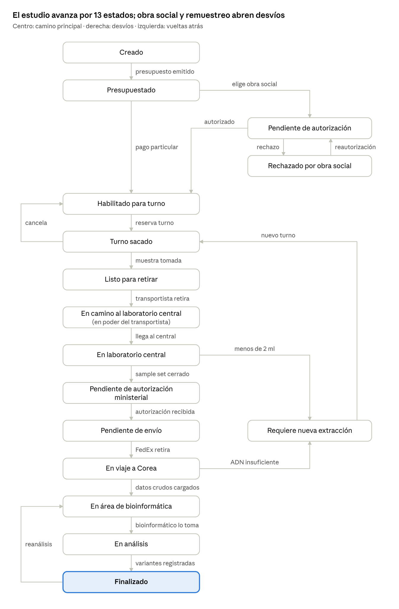

# Léxico Extendido del Lenguaje (LEL) – Sistema de gestión de exoma clínico

Oct 7, 2026 · @Someone

# Introducción

El LEL tiene 109 símbolos (15 sujetos, 41 objetos, 30 verbos y 23 estados) tomados de la entrevista de relevamiento del laboratorio de genética y descritos según el modelo de Leite.

| Clasificación | La Noción responde | El Impacto responde |
|---|---|---|
| Sujeto | ¿Quién es? | ¿Qué hace? |
| Objeto | ¿Qué es? | ¿Qué se hace? |
| Verbo | ¿Para qué / por qué? | ¿Cómo? |
| Estado | ¿Qué significa? | ¿Cómo pasar a otro estado? |

Convenciones usadas:

- Cada impacto sigue la sintaxis Sujeto + Verbo + Objeto, y su sujeto es siempre un símbolo de la sección Sujetos.
- Las nociones e impactos reutilizan los símbolos del glosario (principio de circularidad) y evitan términos ajenos a él (principio de vocabulario mínimo).
- "Sistema" figura como sujeto de las acciones automáticas que el cliente pidió resolver sin intervención humana.
- Quedan fuera de alcance la gerencia y su tablero de control, los APM y la mensajería por WhatsApp, que el cliente postergó o descartó.

# Sujetos

## Usuario

**Noción:** Persona registrada en el sistema con un rol: paciente, médico tratante, administrativo, bioinformático, transportista, gerente médico o administrador general. Opera desde computadora o celular.

**Impactos:**

1. El usuario inicia sesión con sus credenciales de acceso.
2. El usuario ingresa el código de verificación cuando accede desde un dispositivo o una red nuevos.
3. El usuario consulta sus avisos pendientes.

## Médico tratante

**Sinónimos:** médico derivante.

**Noción:** Profesional de la salud externo al laboratorio que atiende la consulta inicial del paciente y sospecha una patología lisosomal. Se registra con matrícula, especialidades (desde el módulo SNOMED), nombre, apellido, teléfono y mail. Es el único que puede iniciar un estudio.

**Impactos:**

1. El médico tratante se registra en el sistema.
2. El médico tratante da de alta al paciente cuando no existe en el sistema.
3. El médico tratante da de alta a los familiares del paciente.
4. El médico tratante da de alta el estudio.
5. El médico tratante agrega genes manualmente al estudio.
6. El médico tratante recibe cupones de descuento del gerente médico.
7. El médico tratante asigna un cupón de descuento al paciente.
8. El médico tratante solicita el reanálisis de un estudio finalizado.
9. El médico tratante recibe el resultado del estudio.

## Paciente

**Noción:** Persona a la que se le realiza el estudio por sospecha de una patología lisosomal. El médico tratante lo da de alta y recibe por mail un usuario y una contraseña provisoria para acceder a su vista. Puede tener más de un estudio en su historial.

**Impactos:**

1. El paciente cambia la contraseña provisoria en su primer ingreso.
2. El paciente consulta el presupuesto del estudio.
3. El paciente elige pagar de forma particular o usar la cobertura de su obra social.
4. El paciente paga el estudio.
5. El paciente aplica un cupón de descuento al pago.
6. El paciente carga una demanda de reautorización cuando la obra social rechaza el estudio.
7. El paciente reserva un turno de extracción.
8. El paciente cancela un turno de extracción.
9. El paciente entrega el consentimiento informado firmado en el centro de extracción.
10. El paciente descarga el resultado del estudio.
11. El paciente consulta al chatbot de pacientes.

## Responsable del paciente menor

**Sinónimos:** padre, madre, tutor.

**Noción:** Adulto a cargo de un paciente menor de 18 años. Los datos registrados son los del paciente, pero es quien realiza el proceso en su nombre.

**Impactos:**

1. El responsable del paciente menor paga el estudio y reserva el turno en nombre del paciente.
2. El responsable del paciente menor firma el consentimiento informado.

## Administrativo del laboratorio

**Sinónimos:** administrativo, administrativo del laboratorio central. El cliente pidió no usar "secretaria".

**Noción:** Empleado del laboratorio central que gestiona las tareas administrativas del estudio. Se registra con nombre, apellido, teléfono y mail. Los centros de extracción no tienen administrativos en el sistema.

**Impactos:**

1. El administrativo emite el presupuesto del estudio.
2. El administrativo registra la autorización o el rechazo de la obra social, gestionados por teléfono fuera del sistema.
3. El administrativo registra el volumen de la muestra recibida.
4. El administrativo programa el retiro del sample set con FedEx.
5. El administrativo carga los datos crudos recibidos de Corea en cada estudio.
6. El administrativo solicita una nueva extracción cuando la muestra resulta insuficiente.

## Bioinformático

**Noción:** Integrante del equipo de bioinformática que analiza los datos crudos de cada estudio con un pipeline propio, fuera del sistema. Se registra con nombre, apellido, mail y teléfono. Los bioinformáticos se reparten los estudios entre ellos.

**Impactos:**

1. El bioinformático recibe la notificación de datos crudos disponibles.
2. El bioinformático consulta la lista de estudios pendientes, con los Pompe urgentes primero.
3. El bioinformático toma un estudio para análisis.
4. El bioinformático registra las variantes encontradas en los genes solicitados.
5. El bioinformático finaliza el análisis del estudio.

## Transportista

**Sinónimos:** motoquero.

**Noción:** Persona que recolecta las muestras de los centros de extracción de su provincia y las lleva al laboratorio central. Hay un transportista por provincia y el traslado está tercerizado: se asume que toda muestra retirada llega.

**Impactos:**

1. El transportista recibe la orden del día cada mañana hábil.
2. El transportista registra el retiro de las muestras en cada centro de extracción.
3. El transportista informa su ubicación durante el recorrido.
4. El transportista registra la llegada al laboratorio central con todas las muestras recolectadas.

## Gerente médico

**Noción:** Responsable médico del laboratorio que administra las patologías y los cupones de descuento. Se registra con los mismos datos que el médico tratante, o lo da de alta el administrador general.

**Impactos:**

1. El gerente médico da de alta las patologías.
2. El gerente médico modifica el síntoma cardinal y los síntomas secundarios de cada patología.
3. El gerente médico genera cupones de descuento.
4. El gerente médico asigna cupones de descuento a los médicos tratantes.

## Administrador general

**Noción:** Usuario opcional, propuesto por el cliente, que centraliza la gestión de usuarios como alternativa al auto registro.

**Impactos:**

1. El administrador general da de alta a médicos tratantes, administrativos, bioinformáticos, transportistas y gerentes médicos.
2. El administrador general asigna el rol de cada usuario.

## Centro de extracción

**Sinónimos:** laboratorio de extracción.

**Noción:** Uno de los 100 laboratorios del país, en su mayoría tercerizados, donde se toma la muestra de sangre. Atiende de lunes a viernes de 9 a 18, tiene su propio turnero y no opera dentro del sistema.

**Impactos:**

1. El centro de extracción toma la muestra de sangre al paciente.
2. El centro de extracción recibe el consentimiento informado firmado.
3. El centro de extracción envía un mensaje al bot de mensajería por cada muestra tomada.
4. El centro de extracción entrega las muestras al transportista.

## Obra social

**Noción:** Entidad de cobertura de salud que cubre un porcentaje del estudio, distinto según cada obra social. Suele rechazar estos estudios y revertir la decisión ante un fallo judicial.

**Impactos:**

1. La obra social autoriza o rechaza la cobertura del estudio.
2. La obra social transfiere el pago dentro de las 24 h de la autorización.
3. La obra social reautoriza el estudio ante una resolución judicial favorable.

## Laboratorio de secuenciación

**Sinónimos:** Corea.

**Noción:** Laboratorio en Corea que lee el ADN de las muestras. Hasta ahora enviaba un informe en PDF por mail; desde el próximo mes enviará los datos crudos de cada estudio.

**Impactos:**

1. El laboratorio de secuenciación lee el ADN de cada muestra del sample set.
2. El laboratorio de secuenciación envía los datos crudos de cada estudio por separado.
3. El laboratorio de secuenciación informa cuando el ADN de una muestra es insuficiente.

## FedEx

**Noción:** Empresa de courier que lleva cada sample set del laboratorio central a Corea. Expone un módulo donde se programa el retiro con día, hora y la URL que debe invocar al retirar.

**Impactos:**

1. FedEx retira el sample set en el día y la hora programados.
2. FedEx invoca la URL del sample set para informar el retiro.

## Ministerio de Salud

**Noción:** Organismo que autoriza la salida de muestras biológicas al exterior. Se accede mediante una API que recibe el CCB y devuelve un PDF de autorización.

**Impactos:**

1. El Ministerio de Salud recibe el CCB del sample set.
2. El Ministerio de Salud emite el PDF de autorización con los pacientes del sample set.

## Sistema

**Sinónimos:** core, sistema central.

**Noción:** Sistema de gestión del laboratorio central que se va a desarrollar. Coordina el circuito del estudio, ejecuta las tareas que no requieren intervención humana e integra los módulos externos.

**Impactos:**

1. El sistema envía al paciente sus credenciales de acceso provisorias.
2. El sistema valida el diagnóstico presuntivo contra los síntomas del paciente.
3. El sistema cambia el estado del estudio ante cada evento del circuito.
4. El sistema arma los sample sets.
5. El sistema genera el CCB y solicita la autorización al Ministerio de Salud.
6. El sistema envía notificaciones por mail y avisos internos.
7. El sistema registra cada operación en el registro financiero.
8. El sistema solicita un código de verificación ante un ingreso desde un dispositivo o una red nuevos.

# Objetos

## Estudio

**Sinónimos:** exoma clínico, sample.

**Noción:** Solicitud de exoma clínico para un paciente: lectura de todos los genes de su ADN a partir de una muestra de sangre y análisis de los genes de interés. Incluye el paciente, los genes a evaluar, la opción de hallazgos secundarios, el presupuesto y la extracción. Siempre está en un único estado.

**Impactos:**

1. El médico tratante da de alta el estudio.
2. El administrativo emite el presupuesto del estudio.
3. El paciente paga el estudio.
4. El sistema cambia el estado del estudio.
5. El bioinformático registra las variantes del estudio.
6. El médico tratante solicita el reanálisis del estudio.

## ADN

**Noción:** Secuencia de unos 3.000 millones de bases, cada una A, C, T o G, que es la misma en todas las células del organismo. Por eso basta una sola extracción por paciente.

**Impactos:**

1. El laboratorio de secuenciación lee el ADN de la muestra.
2. El bioinformático compara el ADN del paciente con el genoma de referencia.

## Genoma de referencia

**Noción:** Secuencia que indica, para cada posición del ADN, la base más representativa de la especie humana.

**Impactos:**

1. El bioinformático compara el ADN del paciente con el genoma de referencia para detectar variantes genéticas.

## Gen

**Noción:** Subsecuencia del ADN que contiene las instrucciones para producir una proteína; puede tener miles de bases. Cada patología lisosomal está asociada a un gen.

**Impactos:**

1. El sistema obtiene de la API de bioinformática los genes asociados a la patología sospechada.
2. El médico tratante agrega genes manualmente al estudio.
3. El bioinformático selecciona el gen en el que registra una variante.

## Variante genética

**Noción:** Base del ADN del paciente que difiere del genoma de referencia. Las variantes de cada gen ya son conocidas y se clasifican en patogénica, benigna (o inocua) o VUS (variante de significado incierto). Solo una variante patogénica confirma la patología.

**Impactos:**

1. El sistema obtiene de la API de bioinformática las variantes conocidas de un gen y su clasificación.
2. El bioinformático selecciona la variante encontrada en el gen.
3. El sistema incluye las variantes en el resultado del estudio.

## Hallazgo secundario

**Noción:** Variante en genes ajenos al diagnóstico presuntivo que el médico tratante elige evaluar de forma opcional. Se analiza con los mismos datos y al mismo tiempo que el resto del estudio.

**Impactos:**

1. El médico tratante indica si el estudio evalúa hallazgos secundarios.
2. El sistema obtiene de la API de bioinformática los genes de hallazgos secundarios.
3. El bioinformático registra las variantes de hallazgos secundarios.

## Patología lisosomal

**Sinónimos:** patología.

**Noción:** Enfermedad genética en la que los lisosomas dejan de degradar los desechos de la célula por una proteína que funciona mal. El laboratorio trabaja con Fabry, Pompe, mucopolisacaridosis tipo 1, mucopolisacaridosis tipo 2, Gaucher y ASMD. Cada una tiene un síntoma cardinal y síntomas secundarios.

**Impactos:**

1. El gerente médico da de alta la patología.
2. El gerente médico modifica los síntomas de la patología.
3. El médico tratante selecciona la patología como diagnóstico presuntivo.

## Diagnóstico presuntivo

**Noción:** Patología lisosomal, o más de una, que el médico tratante sospecha en el paciente. Es obligatorio y determina los genes a analizar.

**Impactos:**

1. El médico tratante registra el diagnóstico presuntivo del paciente.
2. El sistema valida el diagnóstico presuntivo contra los síntomas del paciente.

## Síntoma

**Noción:** Manifestación clínica codificada con la terminología SNOMED, para que todos los médicos registren lo mismo de igual forma ("cefalea" y no "dolor de cabeza"). En cada patología se distingue el síntoma cardinal, el principal, de los síntomas secundarios.

**Impactos:**

1. El médico tratante selecciona los síntomas del paciente desde el módulo SNOMED.
2. El gerente médico define el síntoma cardinal y los síntomas secundarios de cada patología.

## Tipo de sospecha

**Noción:** Origen de la sospecha, obligatorio: clínica, cuando el médico observa síntomas, o familiar, cuando un pariente tiene diagnóstico confirmado y el paciente tiene riesgo por herencia.

**Impactos:**

1. El médico tratante indica el tipo de sospecha al dar de alta al paciente.

## Resumen de historia clínica

**Noción:** Síntesis obligatoria de la historia clínica del paciente. El médico la dicta por audio y se transcribe a texto automáticamente.

**Impactos:**

1. El médico tratante graba el resumen de historia clínica.
2. El sistema transcribe el audio a texto.

## Familiar

**Noción:** Pariente del paciente que puede tener riesgo aumentado por el patrón de herencia. Se registra con parentesco, nombre, síntomas y si ya tiene diagnóstico de alguna patología lisosomal.

**Impactos:**

1. El médico tratante da de alta al familiar del paciente.
2. El sistema envía los familiares a la API de familiograma.

## Familiograma

**Sinónimos:** genograma.

**Noción:** Dibujo en PDF de la familia del paciente que genera la API de familiograma. Es el único dato opcional del paciente: queda vacío cuando el paciente no quiere informar a sus familiares.

**Impactos:**

1. El sistema solicita el familiograma a la API de familiograma.
2. El sistema asocia el familiograma al paciente.

## Presupuesto

**Noción:** Importe fijo del estudio: 500 USD hasta 5 genes y 30 USD por cada gen adicional, con la extracción incluida. Si interviene una obra social se aplica su porcentaje de cobertura.

**Impactos:**

1. El administrativo emite el presupuesto del estudio.
2. El paciente consulta el presupuesto.
3. El paciente aplica un cupón de descuento al presupuesto.

## Pago

**Noción:** Cancelación del presupuesto en un único pago, sin cuotas. El pago particular se simula por ahora (el paciente ingresa el importe y confirma); el de obra social se da por hecho al registrarse la autorización.

**Impactos:**

1. El paciente paga el estudio.
2. El sistema registra el pago en el registro financiero.
3. El sistema habilita al paciente para reservar el turno.

## Registro financiero

**Noción:** Asiento de cada operación económica (pagos, coberturas y descuentos) para conocer la caja y la deuda por obra social y por paciente. Alimentará el futuro tablero de control.

**Impactos:**

1. El sistema registra cada pago en el registro financiero.
2. El sistema registra la deuda pendiente de cada obra social.

## Cupón de descuento

**Noción:** PDF con un código QR, o un código numérico, que otorga el descuento definido por el gerente médico. Lo genera y valida el módulo de cupones; cada médico recibe una cantidad limitada.

**Impactos:**

1. El gerente médico genera el cupón de descuento.
2. El gerente médico asigna el cupón de descuento a un médico tratante.
3. El médico tratante asigna el cupón de descuento a un paciente.
4. El paciente sube el cupón de descuento al pagar.
5. El sistema consulta al módulo de cupones si el cupón está vigente.

## Demanda de reautorización

**Noción:** Solicitud que el paciente asocia a un estudio rechazado por la obra social, con un PDF de resolución judicial favorable, para destrabar la autorización.

**Impactos:**

1. El paciente carga la demanda de reautorización con la resolución judicial.
2. El administrativo registra la nueva respuesta de la obra social.

## Turno de extracción

**Noción:** Franja de 15 minutos para un solo paciente en un centro de extracción, de lunes a viernes de 9 a 18, sin feriados. Solo se reserva con el estudio pagado o autorizado. La inasistencia no se penaliza.

**Impactos:**

1. El paciente elige un centro de extracción en el mapa.
2. El paciente reserva un turno libre del centro.
3. El paciente cancela el turno.
4. El sistema envía al paciente un recordatorio del turno.

## Turnero

**Noción:** Agenda de turnos de extracción de un centro de extracción, con franjas de 15 minutos de lunes a viernes de 9 a 18, sin feriados. Cada centro de extracción tiene su propio turnero.

**Impactos:**

1. El sistema muestra al paciente los turnos libres del turnero de un centro de extracción.
2. El paciente reserva un turno del turnero.
3. El sistema libera el turno en el turnero cuando el paciente lo cancela.

## Mapa

**Noción:** Representación geográfica que muestra los centros de extracción del país y la ubicación del transportista mientras lleva las muestras.

**Impactos:**

1. El paciente consulta en el mapa los centros de extracción para elegir el más cercano.
2. El sistema muestra en el mapa la ubicación del transportista.
3. El administrativo consulta en el mapa por dónde va una muestra.

## Orden de extracción

**Noción:** Documento con la fecha y la hora del turno y las indicaciones para el paciente, por ejemplo que no requiere preparación especial.

**Impactos:**

1. El sistema envía la orden de extracción al paciente.

## Consentimiento informado

**Noción:** Documento, según plantilla del laboratorio, que el paciente imprime, completa y firma (el responsable lo firma si es menor). Viaja en papel a Corea y no se guarda en el sistema.

**Impactos:**

1. El sistema envía el consentimiento informado al paciente.
2. El paciente entrega el consentimiento informado firmado en el centro de extracción.

## Muestra

**Noción:** Tubo con la sangre del paciente. Se registra su volumen en mililitros: con menos de 2 ml hay que volver a extraer, sin costo para el paciente.

**Impactos:**

1. El centro de extracción toma la muestra.
2. El transportista retira la muestra del centro de extracción.
3. El administrativo registra el volumen de la muestra.
4. El sistema muestra en un mapa por dónde va la muestra mientras la lleva el transportista.

## Orden del día

**Noción:** Lista de centros de extracción de una provincia que el transportista recorre cada mañana hábil. El orden lo calcula el módulo de optimización de recorridos y no se puede modificar.

**Impactos:**

1. El sistema genera la orden del día de cada transportista.
2. El transportista recibe la orden del día.
3. El transportista recorre los centros en el orden fijado.

## Laboratorio central

**Noción:** Sede del laboratorio donde se concentran las muestras de todo el país antes de enviarlas a Corea. Es el único lugar donde opera el sistema.

**Impactos:**

1. El transportista entrega las muestras en el laboratorio central.
2. El sistema arma los sample sets con las muestras del laboratorio central.

## Sample set

**Sinónimos:** lote.

**Noción:** Paquete sellado de 10 muestras que se envía a Corea; con 10 el envío es gratuito. Solo un Pompe urgente permite enviarlo incompleto. Una vez cerrado no admite más muestras y viaja como paquete independiente.

**Impactos:**

1. El sistema arma el sample set con las muestras recibidas.
2. El sistema cierra el sample set al llegar a 10 muestras o ante un Pompe urgente.
3. El administrativo programa el retiro del sample set.
4. FedEx retira el sample set.

## Pompe urgente

**Noción:** Estudio con diagnóstico presuntivo de enfermedad de Pompe en un niño o niña menor de 4 meses. Por ser urgente tiene prioridad de envío y de análisis; mantiene el mismo costo y circuito de pago.

**Impactos:**

1. El sistema cierra el sample set sin esperar las 10 muestras.
2. El sistema ubica el Pompe urgente primero en la lista de pendientes del bioinformático.

## CCB

**Noción:** Archivo Excel con los pacientes de un sample set que se envía al Ministerio de Salud para autorizar la salida de las muestras. El Ministerio devuelve un PDF de autorización que viaja con el paquete y se controla en la aduana.

**Impactos:**

1. El sistema genera el CCB al cerrar el sample set.
2. El sistema envía el CCB a la API del Ministerio de Salud.
3. El sistema asocia el CCB y el PDF de autorización a cada estudio.

## Datos crudos

**Noción:** Lectura del ADN de un estudio que envía el laboratorio de secuenciación; por ahora se simula como un archivo de texto con las letras A, C, T y G. Llegan por estudio, no por sample set.

**Impactos:**

1. El administrativo carga los datos crudos en el estudio.
2. El sistema notifica a los bioinformáticos que hay datos crudos disponibles.

## Resultado del estudio

**Sinónimos:** informe.

**Noción:** PDF, según plantilla del laboratorio, que indica si el estudio dio positivo o negativo y qué variantes presenta el paciente. Queda disponible en el sistema para el médico tratante y el paciente.

**Impactos:**

1. El sistema genera el resultado del estudio con las variantes registradas.
2. El sistema notifica el resultado al médico tratante y al paciente.
3. El paciente descarga el resultado del estudio.

## Notificación

**Sinónimos:** aviso, recordatorio.

**Noción:** Comunicación al usuario por mail y como aviso en una lista de pendientes dentro del sistema.

**Impactos:**

1. El sistema envía una notificación por mail.
2. El sistema publica un aviso en la lista de pendientes del usuario.
3. El usuario consulta sus avisos.

## Credenciales de acceso

**Noción:** Usuario y contraseña con los que cada usuario se autentica, más un código de verificación por mail cuando ingresa desde un dispositivo o una red nuevos. Por ahora nadie puede darse de baja ni modificar sus datos.

**Impactos:**

1. El sistema envía las credenciales provisorias al paciente.
2. El paciente cambia la contraseña provisoria.
3. El sistema envía el código de verificación al mail del usuario.

## API de bioinformática

**Noción:** Módulo externo, desarrollado por otro equipo, que conoce la relación patología– gen, los genes de hallazgos secundarios y las variantes de cada gen con su clasificación.

**Impactos:**

1. El sistema consulta la API de bioinformática para obtener los genes de una patología.
2. El sistema consulta la API de bioinformática para obtener las variantes de un gen.

## API de obras sociales

**Noción:** Módulo externo con las obras sociales con las que trabaja el laboratorio y su porcentaje de cobertura.

**Impactos:**

1. El sistema consulta la API de obras sociales para mostrar las coberturas al paciente.

## Módulo SNOMED

**Noción:** Base de datos externa, cargada por otro equipo, con los términos médicos de SNOMED, como síntomas y especialidades médicas.

**Impactos:**

1. El sistema consulta el módulo SNOMED a medida que el médico escribe y muestra los términos que coinciden con lo escrito.
2. El médico tratante o el gerente médico elige el síntoma entre los términos sugeridos.
3. El médico tratante o el gerente médico selecciona sus especialidades desde el módulo SNOMED.

## API de familiograma

**Noción:** Módulo externo que recibe los familiares con su parentesco y devuelve el familiograma en PDF.

**Impactos:**

1. El sistema envía los familiares a la API de familiograma.
2. El sistema asocia al paciente el PDF devuelto.

## Módulo de cupones

**Noción:** Módulo externo que genera los cupones de descuento, valida su vigencia y los vence cuando se usan.

**Impactos:**

1. El sistema solicita al módulo de cupones un cupón nuevo.
2. El sistema consulta al módulo de cupones si el cupón está vigente.
3. El sistema informa al módulo de cupones el uso del cupón para que lo venza y no pueda volver a usarse.

## Módulo de optimización de recorridos

**Noción:** Servicio externo, cuya contratación está en evaluación, que recibe las direcciones de los centros a visitar y devuelve el orden del recorrido.

**Impactos:**

1. El sistema envía al módulo las direcciones de los centros de extracción de cada transportista.
2. El sistema recibe el orden del recorrido para la orden del día.

## Bot de mensajería

**Noción:** Número del laboratorio central (Telegram) que recibe un mensaje automático por cada muestra tomada. Reemplaza el llamado telefónico que los centros de extracción olvidaban hacer.

**Impactos:**

1. El centro de extracción envía al bot de mensajería el aviso de muestra tomada.
2. El sistema cambia el estudio a Listo para retirar al recibir el mensaje.

## Chatbot de pacientes

**Noción:** Módulo externo, especializado en las patologías lisosomales, que responde las preguntas de los pacientes.

**Impactos:**

1. El paciente escribe una pregunta en la interfaz del sistema.
2. El sistema delega la pregunta al chatbot de pacientes y muestra la respuesta.

# Verbos

## Registrarse

**Sinónimos:** auto darse de alta.

**Noción:** Para que médicos tratantes, administrativos, bioinformáticos y gerentes médicos obtengan acceso al sistema con su rol. El cliente aceptó tanto el auto registro como el alta por el administrador general.

**Impactos:**

1. El médico tratante completa matrícula, especialidades, nombre, apellido, teléfono y mail.
2. El gerente médico completa los mismos datos que el médico tratante.
3. El administrativo completa nombre, apellido, teléfono y mail.
4. El bioinformático completa nombre, apellido, mail y teléfono.
5. El sistema crea las credenciales de acceso del usuario.
6. El administrador general da de alta a médicos tratantes, gerentes médicos, administrativos, bioinformáticos y transportistas, como alternativa al auto registro.

## Iniciar sesión

**Noción:** Para proteger los datos genéticos de los pacientes, cuya filtración podría perjudicarlos y derivar en juicios contra el laboratorio.

**Impactos:**

1. El usuario ingresa sus credenciales de acceso.
2. El sistema detecta si el dispositivo o la red son nuevos.
3. El sistema envía un código de verificación al mail del usuario.
4. El usuario ingresa el código de verificación.

## Dar de alta paciente

**Noción:** Para registrar al paciente durante la misma consulta médica, porque puede que no vuelva.

**Impactos:**

1. El médico tratante carga DNI, nombre, apellido, fecha de nacimiento, teléfono y mail.
2. El médico tratante registra el diagnóstico presuntivo y el tipo de sospecha.
3. El médico tratante graba el resumen de historia clínica.
4. El médico tratante carga la lista de síntomas del paciente, seleccionándolos desde el módulo SNOMED.
5. El médico tratante da de alta a los familiares, si el paciente los informa.
6. El sistema valida el diagnóstico presuntivo.
7. El sistema envía las credenciales de acceso al paciente.

## Validar diagnóstico presuntivo

**Noción:** Para impedir que se registre un diagnóstico presuntivo que no coincide con los síntomas del paciente. No infiere la patología: solo controla la que eligió el médico.

**Impactos:**

1. El sistema obtiene el síntoma cardinal y los síntomas secundarios de la patología sospechada.
2. El sistema acepta el alta si el paciente presenta el síntoma cardinal o al menos dos síntomas secundarios.
3. El sistema rechaza el alta del paciente si no se cumple la regla.

## Registrar familiograma

**Noción:** Para identificar familiares con riesgo aumentado a los que conviene estudiar (screening).

**Impactos:**

1. El médico tratante da de alta cada familiar con parentesco, nombre, síntomas y diagnóstico previo.
2. El sistema envía los familiares a la API de familiograma.
3. El sistema asocia el familiograma en PDF al paciente.

## Dar de alta estudio

**Noción:** Para iniciar el circuito del exoma clínico; solo un médico tratante puede hacerlo.

**Impactos:**

1. El médico tratante selecciona al paciente o lo da de alta.
2. El sistema obtiene de la API de bioinformática los genes de la patología sospechada.
3. El médico tratante agrega genes manualmente si sospecha otra causa.
4. El médico tratante indica si evalúa hallazgos secundarios.
5. El sistema registra el estudio en estado Creado.

## Emitir presupuesto

**Noción:** Para informar al paciente el costo del estudio antes del pago.

**Impactos:**

1. El administrativo emite el presupuesto según la cantidad de genes.
2. El sistema publica el presupuesto en la vista del paciente.
3. El sistema notifica al paciente.

## Pagar estudio

**Noción:** Para habilitar la reserva del turno: sin pago no hay turno.

**Impactos:**

1. El paciente elige pago particular o cobertura de obra social.
2. El paciente aplica un cupón de descuento, si tiene uno.
3. El paciente confirma el pago simulado en un único pago.
4. El sistema registra el pago en el registro financiero.
5. El sistema habilita la reserva del turno.

## Aplicar cupón

**Noción:** Para descontar del presupuesto el beneficio que el médico tratante otorgó al paciente.

**Impactos:**

1. El paciente sube el PDF del cupón o ingresa su código.
2. El sistema consulta al módulo de cupones si el cupón está vigente.
3. El sistema aplica el descuento al presupuesto.
4. El sistema informa al módulo de cupones que el cupón fue utilizado para que lo venza.

## Generar cupón

**Noción:** Para que el laboratorio otorgue descuentos a través de los médicos tratantes.

**Impactos:**

1. El gerente médico define el descuento del cupón.
2. El sistema solicita el cupón al módulo de cupones.
3. El gerente médico asigna una cantidad de cupones a un médico tratante.

## Asignar cupón

**Noción:** Para que el médico tratante decida a qué pacientes beneficia con su cantidad limitada de cupones.

**Impactos:**

1. El médico tratante elige uno de sus cupones disponibles.
2. El médico tratante asigna el cupón al paciente.
3. El sistema notifica al paciente el cupón asignado.

## Autorizar cobertura

**Noción:** Para que un estudio cubierto por obra social avance al turno; sin autorización no avanza. Una autorización equivale a un pago.

**Impactos:**

1. El administrativo gestiona la autorización con la obra social por teléfono, fuera del sistema.
2. El administrativo registra la autorización o el rechazo.
3. El sistema registra el estudio como autorizado y pagado.
4. El sistema notifica al paciente.

## Solicitar reautorización

**Noción:** Para destrabar un estudio rechazado cuando la justicia falla a favor del paciente, algo frecuente con estas obras sociales.

**Impactos:**

1. El paciente carga la demanda de reautorización con el PDF de la resolución judicial.
2. El sistema vuelve el estudio a Pendiente de autorización.
3. El administrativo registra la nueva respuesta de la obra social.

## Reservar turno

**Noción:** Para que el paciente acuda a un centro de extracción a tomarse la muestra.

**Impactos:**

1. El paciente ve los centros de extracción en un mapa.
2. El paciente elige el centro que le queda más cerca.
3. El paciente elige un turno libre de 15 minutos.
4. El sistema envía la orden de extracción y el consentimiento informado.
5. El sistema envía un recordatorio antes del turno.

## Cancelar turno

**Noción:** Para liberar un turno al que el paciente no puede asistir; cancelar no tiene costo.

**Impactos:**

1. El paciente cancela el turno.
2. El sistema libera el turno en el turnero del centro.
3. El paciente reserva un nuevo turno.

## Registrar toma de muestra

**Noción:** Para que el laboratorio central sepa, sin intervención de personas, que hay una muestra lista y no quede días parada en el centro de extracción.

**Impactos:**

1. El centro de extracción toma la muestra.
2. El centro de extracción envía el mensaje al bot de mensajería.
3. El sistema cambia el estudio a Listo para retirar.

## Generar orden del día

**Noción:** Para que cada transportista sepa cada mañana hábil qué centros de extracción visitar y en qué orden.

**Impactos:**

1. El sistema reúne los centros de extracción de la provincia con muestras listas para retirar.
2. El sistema envía las direcciones al módulo de optimización de recorridos.
3. El sistema asigna la orden del día al transportista.

## Retirar muestras

**Noción:** Para trasladar las muestras desde los centros de extracción al laboratorio central y saber en todo momento dónde están.

**Impactos:**

1. El transportista llega al centro de extracción indicado en la orden del día.
2. El transportista registra el retiro de las muestras.
3. El sistema cambia esos estudios a En camino al laboratorio central.
4. El sistema muestra en el mapa la ubicación del transportista.

## Registrar llegada al laboratorio central

**Noción:** Para confirmar la recepción de las muestras y disparar, sin intervención, el armado de sample sets.

**Impactos:**

1. El transportista registra la llegada con todas las muestras recolectadas.
2. El sistema cambia esos estudios a En laboratorio central.
3. El sistema arma los sample sets.

## Armar sample set

**Noción:** Para enviar las muestras a Corea en paquetes de 10 y obtener el envío gratuito.

**Impactos:**

1. El sistema agrega cada muestra recibida al sample set abierto.
2. El sistema cierra el sample set al llegar a 10 muestras.
3. El sistema cierra el sample set incompleto si contiene un Pompe urgente.
4. El sistema solicita la autorización ministerial.

## Solicitar autorización ministerial

**Noción:** Para cumplir la exigencia del Ministerio de Salud de autorizar la salida de muestras al exterior.

**Impactos:**

1. El sistema genera el CCB con los pacientes del sample set.
2. El sistema envía el CCB a la API del Ministerio de Salud.
3. El Ministerio de Salud devuelve el PDF de autorización.
4. El sistema asocia el CCB y el PDF a cada estudio.

## Programar retiro

**Noción:** Para que FedEx retire el sample set sellado y el sistema actualice los estados sin intervención.

**Impactos:**

1. El administrativo elige un día y una hora hábiles, de lunes a viernes de 9 a 18.
2. El administrativo envía al módulo de FedEx el día, la hora y la URL del sample set.
3. FedEx invoca la URL al retirar el paquete.
4. El sistema cambia el sample set y sus estudios a En viaje a Corea.

## Cargar datos crudos

**Noción:** Para que el equipo de bioinformática analice las variantes con su propio pipeline.

**Impactos:**

1. El administrativo carga los datos crudos en el estudio.
2. El sistema cambia el estudio a En área de bioinformática.
3. El sistema notifica a todos los bioinformáticos.

## Tomar estudio

**Noción:** Para que los demás bioinformáticos sepan que el estudio ya está en análisis y no lo tomen.

**Impactos:**

1. El bioinformático elige un estudio de la lista de pendientes, con los Pompe urgentes primero.
2. El bioinformático toma el estudio.
3. El sistema cambia el estudio a En análisis.

## Registrar variante

**Noción:** Para dejar constancia de las variantes encontradas en los genes solicitados y fundamentar el resultado.

**Impactos:**

1. El bioinformático elige el gen.
2. El sistema consulta a la API de bioinformática las variantes de ese gen.
3. El bioinformático selecciona la variante encontrada.
4. El sistema registra la clasificación de la variante.

## Informar resultado

**Noción:** Para comunicar el diagnóstico al médico tratante y al paciente.

**Impactos:**

1. El bioinformático finaliza el análisis.
2. El sistema genera el resultado en PDF.
3. El sistema notifica al médico tratante y al paciente por mail y por aviso.
4. El sistema cambia el estudio a Finalizado.

## Solicitar reanálisis

**Noción:** Para analizar otros genes del mismo exoma sin nueva extracción ni nueva lectura, porque el ADN no cambia.

**Impactos:**

1. El médico tratante selecciona un estudio finalizado.
2. El médico tratante elige la nueva patología o los nuevos genes.
3. El sistema devuelve el estudio a En área de bioinformática.

## Solicitar nueva extracción

**Sinónimos:** remuestrear.

**Noción:** Para reemplazar una muestra con menos de 2 ml o con ADN desnaturalizado. No tiene costo para el paciente y se mantiene el mismo estudio.

**Impactos:**

1. El administrativo registra que la muestra es insuficiente.
2. El sistema cambia el estudio a Requiere nueva extracción.
3. El sistema notifica al paciente y al médico tratante.
4. El paciente reserva un nuevo turno.

## Dar de alta patología

**Noción:** Para definir las patologías con las que trabaja el laboratorio y los síntomas que validan el diagnóstico presuntivo.

**Impactos:**

1. El gerente médico carga la patología.
2. El gerente médico indica el síntoma cardinal y los síntomas secundarios.
3. El gerente médico modifica la patología cuando lo necesite.

## Notificar

**Noción:** Para que cada usuario se entere de lo que tiene pendiente sin depender de llamados telefónicos.

**Impactos:**

1. El sistema envía un mail.
2. El sistema publica un aviso en la lista de pendientes.
3. El usuario consulta sus avisos.

# Estados

El estudio pasa por 16 estados, el sample set por 5 y el cupón de descuento por 2. Cada impacto indica qué sujeto, con qué acción, provoca el paso al siguiente estado.

*ciclo de vida del estudio · 16 estados*

La obra social puede demorar o trabar el turno, y una muestra insuficiente obliga a reservar uno nuevo; el reanálisis vuelve a bioinformática sin nueva extracción.

# Estados del estudio

## Creado

**Noción:** El médico tratante dio de alta el estudio y todavía no tiene presupuesto.

**Impactos:**

1. El administrativo emite el presupuesto, y el estudio pasa a Presupuestado.

## Presupuestado

**Noción:** El paciente ya ve el presupuesto y debe pagar o elegir su obra social.

**Impactos:**

1. El paciente paga el estudio de forma particular, y el estudio pasa a Habilitado para turno.
2. El paciente elige la cobertura de su obra social, y el estudio pasa a Pendiente de autorización.

## Pendiente de autorización

**Noción:** El estudio espera la respuesta de la obra social y no permite reservar turno.

**Impactos:**

1. El administrativo registra la autorización, y el estudio pasa a Habilitado para turno.
2. El administrativo registra el rechazo, y el estudio pasa a Rechazado por obra social.

## Rechazado por obra social

**Noción:** La obra social negó la cobertura, por lo general alegando falta de evidencia del beneficio del estudio.

**Impactos:**

1. El paciente carga la demanda de reautorización, y el estudio vuelve a Pendiente de autorización.

## Habilitado para turno

**Noción:** El estudio está pagado o autorizado y el paciente puede reservar el turno.

**Impactos:**

1. El paciente reserva un turno de extracción, y el estudio pasa a Turno sacado.

## Turno sacado

**Noción:** El paciente tiene un turno reservado en un centro de extracción.

**Impactos:**

1. El centro de extracción envía el mensaje de muestra tomada, y el estudio pasa a Listo para retirar.
2. El paciente cancela el turno, y el estudio vuelve a Habilitado para turno.

## Listo para retirar

**Noción:** La muestra fue tomada y espera en el centro de extracción al transportista.

**Impactos:**

1. El transportista registra el retiro de las muestras del centro, y el estudio pasa a En camino al laboratorio central.

## En camino al laboratorio central

**Sinónimos:** en poder del transportista.

**Noción:** El transportista lleva la muestra y su ubicación se ve en el mapa.

**Impactos:**

1. El transportista registra la llegada al laboratorio central, y el estudio pasa a En laboratorio central.

## En laboratorio central

**Noción:** La muestra está en el laboratorio central y espera completar un sample set.

**Impactos:**

1. El sistema cierra el sample set que contiene la muestra, y el estudio pasa a Pendiente de autorización ministerial.
2. El administrativo registra un volumen menor a 2 ml, y el estudio pasa a Requiere nueva extracción.

## Pendiente de autorización ministerial

**Noción:** El sample set de la muestra está cerrado y espera el PDF de autorización del Ministerio de Salud para salir del país.

**Impactos:**

1. El Ministerio de Salud devuelve el PDF de autorización, y el estudio pasa a Pendiente de envío.

## Pendiente de envío

**Sinónimos:** esperando retiro.

**Noción:** La muestra está en un sample set sellado y autorizado, y espera que FedEx lo retire.

**Impactos:**

1. FedEx retira el sample set, y el estudio pasa a En viaje a Corea.

## En viaje a Corea

**Noción:** La muestra viaja o está en lectura en el laboratorio de secuenciación. Desde aquí cada estudio sigue de forma individual.

**Impactos:**

1. El administrativo carga los datos crudos, y el estudio pasa a En área de bioinformática.
2. El administrativo registra que el ADN es insuficiente, y el estudio pasa a Requiere nueva extracción.

## En área de bioinformática

**Noción:** Los datos crudos están disponibles y ningún bioinformático tomó todavía el estudio.

**Impactos:**

1. El bioinformático toma el estudio, y el estudio pasa a En análisis.

## En análisis

**Noción:** Un bioinformático está analizando el estudio; los demás ya no pueden tomarlo.

**Impactos:**

1. El bioinformático registra las variantes y finaliza el análisis, y el estudio pasa a Finalizado.

## Finalizado

**Noción:** El resultado del estudio está disponible para el médico tratante y el paciente.

**Impactos:**

1. El médico tratante solicita un reanálisis, y el estudio vuelve a En área de bioinformática.

## Requiere nueva extracción

**Noción:** La muestra no sirve (menos de 2 ml o ADN desnaturalizado) y hay que volver a extraer, sin costo y dentro del mismo estudio.

**Impactos:**

1. El paciente reserva un nuevo turno, y el estudio pasa a Turno sacado.

# Estados del sample set

## En armado

**Noción:** El sample set está abierto y acumula las muestras que llegan al laboratorio central.

**Impactos:**

1. El sistema agrega la décima muestra, y el sample set pasa a Cerrado.
2. El sistema agrega un Pompe urgente, y el sample set pasa a Cerrado aunque esté incompleto.

## Cerrado

**Noción:** El sample set está sellado, no admite más muestras y espera la autorización ministerial.

**Impactos:**

1. El Ministerio de Salud devuelve el PDF de autorización, y el sample set pasa a Pendiente de retiro.

## Pendiente de retiro

**Noción:** El sample set está autorizado y espera que el administrativo programe el retiro.

**Impactos:**

1. El administrativo programa el retiro con FedEx, y el sample set pasa a Retiro programado.

## Retiro programado

**Noción:** FedEx tiene el día, la hora y la URL para retirar el sample set.

**Impactos:**

1. FedEx invoca la URL del sample set al retirarlo, y el sample set pasa a Despachado.

## Despachado

**Noción:** El sample set viaja a Corea y todos sus estudios están En viaje a Corea. Es el estado final del sample set.

**Impactos:**

1. El laboratorio de secuenciación procesa cada estudio por separado, y el sample set ya no cambia de estado.

# Estados del cupón de descuento

## Vigente

**Noción:** El cupón fue generado y todavía no se usó.

**Impactos:**

1. El paciente aplica el cupón al pago, y el cupón pasa a Utilizado.

## Utilizado

**Noción:** El módulo de cupones venció el cupón y no puede volver a usarse. Es un estado final.

**Impactos:**

1. El sistema rechaza cualquier nuevo uso del cupón, que permanece en Utilizado.

# Observaciones a validar con el cliente

La entrevista deja nueve puntos abiertos; el LEL adopta el supuesto indicado en cada uno hasta que el cliente lo confirme.

1. **Patologías:** el cliente habla de "cinco patologías" pero enumera seis (Fabry, Pompe, MPS 1, MPS 2, Gaucher y ASMD). Se corrigió la transcripción automática: "bucosporiasis sacralidosis" es mucopolisacaridosis y "Goyer" es Gaucher.
2. **Validación del diagnóstico presuntivo:** un paciente con sospecha familiar puede no tener síntomas. ¿La regla del síntoma cardinal o dos secundarios también se aplica en ese caso?
3. **Cobertura parcial:** si la obra social cubre solo un porcentaje, ¿el paciente paga la diferencia antes de reservar el turno?
4. **Volumen de la muestra:** no se definió quién registra los mililitros. Se asumió el administrativo al recibir la muestra en el laboratorio central.
5. **Datos crudos:** se asumió que el administrativo los carga en el sistema, como hacía con el PDF de Corea.
6. **Resultado del estudio:** se asumió que el sistema genera el PDF con la plantilla a partir de las variantes registradas.
7. **Inasistencia al turno:** ¿cómo se detecta y quién devuelve el estudio a Habilitado para turno? La idea de perder el pago a la quinta inasistencia quedó sin confirmar.
8. **Reanálisis:** ¿tiene costo por los genes nuevos y se registra en el mismo estudio o como un estudio nuevo del historial?
9. **Nombres de estados:** el cliente nombró Creado, Turno sacado, Listo para retirar, En camino al laboratorio central, En viaje a Corea, En área de bioinformática y En análisis. El resto de los estados son nombres propuestos.
