# Modelo de datos – Sistema de gestión de exoma clínico

Nov 12, 2026

# Introducción

El modelo tiene 39 tablas: las 2 de la migración inicial (`roles` y `usuarios`), que se respetan tal cual, y 37 nuevas que salen de los símbolos de [lel.md](lel.md) y de los episodios de [escenarios.md](escenarios.md). Es el esquema de referencia para que las migraciones de cada escenario no choquen entre sí. Este documento no crea migraciones: cada tabla la crea la migración del primer escenario que la necesita (ver [Orden sugerido de las migraciones](#orden-sugerido-de-las-migraciones)).

Convenciones usadas:

- Tablas y columnas en español y en `snake_case`, con los nombres del LEL. Las tablas van en plural.
- Clave primaria `id bigint generated always as identity`, como en `usuarios`. Hay tres excepciones: los perfiles de rol usan `usuario_id` como clave primaria (relación 1:1 con `usuarios`), las tablas intermedias usan una clave compuesta y los catálogos con código natural usan `codigo text`.
- Las claves foráneas se llaman `<entidad>_id`. Las que apuntan a un usuario llevan el nombre del rol (`medico_tratante_id`, `bioinformatico_id`) o terminan en `_por` cuando registran quién hizo la acción (`emitido_por`). La base no controla el rol del usuario referenciado: lo controla core.
- Fechas en `timestamptz` con sufijo `_en` (`creado_en`, `tomada_en`). Un `_en` nulo significa que eso todavía no pasó.
- Toda columna es `not null`, salvo tres casos: los `_en`, `_path` y `_por` de cosas que pasan después de crear la fila, las columnas que la descripción marca como nulas u opcionales, y las del diagrama con cardinalidad `|o`. Las migraciones tienen que respetar esto.
- Estados y valores cerrados en `text` con un `check (… in (…))`. En Python, el enum de cada estado es la fuente para el código.
- Importes en USD con `numeric(10,2)`, porcentajes con `numeric(5,2)` y coordenadas con `numeric(9,6)`.
- Los archivos (PDF, audio, datos crudos, Excel) van a Supabase Storage en un bucket privado. La tabla guarda la ruta en una columna `*_path`.
- No hay bajas (restricción de E03): las claves foráneas quedan con `on delete restrict` y no se borran filas. Lo que deja de usarse se marca con `activo` o con un estado.
- De los módulos externos se guarda solo el código y una copia del nombre de lo que se eligió, no el catálogo entero. Apigen sigue siendo la fuente de los genes, las variantes y la relación patología–gen.
- RLS activado en todas las tablas y sin políticas (decisión S4 de [decisiones.md](decisiones.md)).
- En la columna Clave: **PK** clave primaria, **FK →** clave foránea, **UK** valor único.

# Diagrama entidad-relación

El diagrama muestra las entidades y sus relaciones; los atributos están en la tabla de cada entidad. Para que se pueda leer, no se dibujan las claves foráneas de auditoría (`*_por`), salvo `cupones.generado_por`, que es la relación del gerente médico con sus cupones (E37).

```mermaid
erDiagram
    %% Usuarios y acceso
    roles ||--o{ usuarios : "rol"
    usuarios ||--o| medicos : "perfil"
    usuarios ||--o| transportistas : "perfil"
    usuarios ||--o| pacientes : "cuenta"
    usuarios ||--o{ dispositivos_confiables : "verificó"
    usuarios ||--o{ codigos_verificacion : "recibe"
    usuarios ||--o{ notificaciones : "recibe"
    medicos ||--o{ medico_especialidades : "tiene"
    terminos_snomed ||--o{ medico_especialidades : "codifica"
    provincias ||--o| transportistas : "asignada a"
    provincias ||--o{ centros_extraccion : "agrupa"

    %% Catálogo sin relaciones: core lo consulta para turnos, órdenes del día y retiros
    feriados {
        date fecha PK
    }

    %% Pacientes y datos clínicos
    medicos ||--o{ pacientes : "da de alta"
    pacientes ||--|{ diagnosticos_presuntivos : "sospecha"
    patologias ||--o{ diagnosticos_presuntivos : "es sospechada"
    pacientes ||--o{ paciente_sintomas : "presenta"
    terminos_snomed ||--o{ paciente_sintomas : "codifica"
    pacientes ||--o{ familiares : "informa"
    familiares ||--o{ familiar_sintomas : "presenta"
    terminos_snomed ||--o{ familiar_sintomas : "codifica"
    familiares ||--o{ familiar_patologias : "tiene diagnóstico"
    patologias ||--o{ familiar_patologias : "diagnosticada en"
    patologias ||--|{ patologia_sintomas : "se valida con"
    terminos_snomed ||--o{ patologia_sintomas : "codifica"

    %% Estudio y análisis
    pacientes ||--o| estudios : "estudio"
    medicos ||--o{ estudios : "da de alta"
    estudios ||--|{ historial_estados : "registra"
    usuarios |o--o{ historial_estados : "cambia"
    estudios |o--o{ notificaciones : "origina"
    estudios ||--|{ analisis : "se analiza en"
    usuarios |o--o{ analisis : "toma (bioinformático)"
    analisis ||--o{ analisis_patologias : "evalúa"
    patologias ||--o{ analisis_patologias : "evaluada en"
    analisis ||--|{ analisis_genes : "pide"
    analisis ||--o{ variantes_encontradas : "registra"

    %% Presupuesto, pagos y cupones
    estudios ||--o| presupuestos : "presupuesto"
    estudios ||--o| coberturas : "cobertura"
    obras_sociales ||--o{ coberturas : "cubre"
    coberturas ||--o{ demandas_reautorizacion : "reclama"
    estudios ||--o{ pagos : "recibe"
    cupones |o--o| pagos : "descuenta"
    usuarios ||--o{ cupones : "genera (gerente médico)"
    medicos |o--o{ cupones : "recibe"
    pacientes |o--o{ cupones : "recibe"
    estudios ||--o{ asientos_financieros : "genera"
    pagos |o--o{ asientos_financieros : "origina"
    obras_sociales |o--o{ asientos_financieros : "adeuda"

    %% Turnos, extracción y logística
    estudios ||--o{ turnos_extraccion : "reserva"
    centros_extraccion ||--o{ turnos_extraccion : "atiende"
    turnos_extraccion ||--o| muestras : "produce"
    estudios ||--o{ muestras : "tiene"
    centros_extraccion |o--o{ mensajes_bot : "envía"
    estudios |o--o{ mensajes_bot : "informa"
    transportistas ||--o{ ordenes_del_dia : "recorre"
    ordenes_del_dia ||--|{ paradas_orden_del_dia : "visita"
    centros_extraccion ||--o{ paradas_orden_del_dia : "es visitado"
    ordenes_del_dia |o--o{ muestras : "traslada"

    %% Envío a Corea
    sample_sets |o--o{ muestras : "contiene"
```

# 1. Usuarios y acceso

## roles

**LEL:** Usuario (rol). **Ya existe** en la migración inicial.

Los 7 roles del LEL. Son datos fijos que carga la migración.

| Atributo | Tipo | Clave | Descripción |
|---|---|---|---|
| codigo | text | PK | `paciente`, `medico_tratante`, `administrativo`, `bioinformatico`, `transportista`, `gerente_medico`, `administrador_general` |
| nombre | text | UK | Nombre para mostrar |

## usuarios

**LEL:** Usuario, Credenciales de acceso. **Ya existe** en la migración inicial.

Persona registrada con un único rol. Los pacientes también son usuarios: el sistema crea su usuario en el alta del paciente (E06).

| Atributo | Tipo | Clave | Descripción |
|---|---|---|---|
| id | bigint | PK | |
| email | text | UK | Único sin distinguir mayúsculas (índice `usuarios_email_unico`) |
| hash_contrasena | text | | Hash scrypt de Werkzeug |
| nombre | text | | |
| apellido | text | | |
| rol_codigo | text | FK → roles | |
| activo | boolean | | Por defecto `true` |
| creado_en | timestamptz | | |
| actualizado_en | timestamptz | | |
| telefono | text | | **Columna nueva propuesta.** La piden E01, E02 y E06. Nula para el administrador general |
| debe_cambiar_contrasena | boolean | | **Columna nueva propuesta.** `true` mientras el paciente tiene la contraseña provisoria (E05). Por defecto `false` |

**Escenarios:** E01–E05.

## medicos

**LEL:** Médico tratante, Gerente médico.

Perfil 1:1 de los usuarios con rol `medico_tratante` o `gerente_medico`, que se registran con los mismos datos (E01). Nombre, apellido, mail y teléfono están en `usuarios`.

| Atributo | Tipo | Clave | Descripción |
|---|---|---|---|
| usuario_id | bigint | PK, FK → usuarios | |
| matricula | text | UK | Se asume correcta (E01) |
| creado_en | timestamptz | | |

**Escenarios:** E01, E03.

## medico_especialidades

**LEL:** Médico tratante (especialidades), Módulo SNOMED.

| Atributo | Tipo | Clave | Descripción |
|---|---|---|---|
| medico_id | bigint | PK, FK → medicos | |
| termino_codigo | text | PK, FK → terminos_snomed | Especialidad elegida desde el módulo SNOMED |

**Escenarios:** E01.

## transportistas

**LEL:** Transportista.

Perfil 1:1 de los usuarios con rol `transportista`. Hay un transportista por provincia.

| Atributo | Tipo | Clave | Descripción |
|---|---|---|---|
| usuario_id | bigint | PK, FK → usuarios | |
| provincia_id | bigint | UK, FK → provincias | El único valor permite un transportista por provincia |
| latitud | numeric(9,6) | | Última ubicación informada durante el recorrido (E25). Nula hasta el primer informe |
| longitud | numeric(9,6) | | |
| ubicacion_en | timestamptz | | Cuándo informó esa ubicación |

**Escenarios:** E03, E23–E26.

## dispositivos_confiables

**LEL:** Credenciales de acceso (dispositivo o red nuevos).

Cada combinación de dispositivo y red desde la que el usuario ya validó un código de verificación. Si la combinación no está, el sistema pide un código (E04).

| Atributo | Tipo | Clave | Descripción |
|---|---|---|---|
| id | bigint | PK | |
| usuario_id | bigint | FK → usuarios | |
| huella_hash | text | | Hash del dispositivo (cookie del navegador) y de la red (IP). Nunca se guarda en claro |
| creado_en | timestamptz | | |
| ultimo_ingreso_en | timestamptz | | |

**Restricciones:** único (`usuario_id`, `huella_hash`).

**Escenarios:** E04.

## codigos_verificacion

**LEL:** Credenciales de acceso (código de verificación).

| Atributo | Tipo | Clave | Descripción |
|---|---|---|---|
| id | bigint | PK | |
| usuario_id | bigint | FK → usuarios | |
| codigo_hash | text | | El código que va por mail, hasheado |
| huella_hash | text | | Dispositivo y red que lo pidieron. Al validarlo, se agregan a `dispositivos_confiables` |
| intentos | smallint | | Intentos fallidos; al llegar al máximo, el código deja de valer |
| expira_en | timestamptz | | Por ejemplo, 10 minutos después de enviado |
| usado_en | timestamptz | | |
| creado_en | timestamptz | | |

**Escenarios:** E04.

# 2. Catálogos

## provincias

**LEL:** Transportista, Orden del día ("de su provincia").

Datos fijos: las 24 jurisdicciones del país.

| Atributo | Tipo | Clave | Descripción |
|---|---|---|---|
| id | bigint | PK | |
| nombre | text | UK | |

**Escenarios:** E03, E19, E23.

## feriados

**LEL:** Turno de extracción, Turnero, Orden del día ("sin feriados").

Días sin turnos, sin orden del día y sin retiros de FedEx. Se cargan por año con los seeds.

| Atributo | Tipo | Clave | Descripción |
|---|---|---|---|
| fecha | date | PK | |
| descripcion | text | | |

**Escenarios:** E19, E23, E30.

## terminos_snomed

**LEL:** Síntoma, Módulo SNOMED.

Copia local de cada término SNOMED que alguien eligió, para que las demás tablas lo referencien por código. No es el catálogo completo: ese vive en el módulo SNOMED. Se inserta o actualiza al elegir un término (E07).

| Atributo | Tipo | Clave | Descripción |
|---|---|---|---|
| codigo | text | PK | Identificador del concepto en SNOMED |
| termino | text | | Texto para mostrar ("Cefalea") |
| tipo | text | | `sintoma` o `especialidad` |

**Escenarios:** E01, E06, E07, E09, E36.

## patologias

**LEL:** Patología lisosomal.

Patologías con las que trabaja el laboratorio. Los genes no se guardan: los devuelve Apigen a partir de `codigo_apigen`.

| Atributo | Tipo | Clave | Descripción |
|---|---|---|---|
| id | bigint | PK | |
| codigo_apigen | text | UK | `FABRY`, `POMPE`, `GAUCHER`, `MPS1`, `ASMD` o el de una patología propia del grupo cargada con `alta_patologia` |
| nombre | text | UK | |
| activa | boolean | | Por defecto `true`. Reemplaza la baja |
| creado_por | bigint | FK → usuarios | Gerente médico |
| creado_en | timestamptz | | |
| actualizado_en | timestamptz | | |

**Escenarios:** E08, E10, E36.

## patologia_sintomas

**LEL:** Patología lisosomal, Síntoma (cardinal y secundarios).

| Atributo | Tipo | Clave | Descripción |
|---|---|---|---|
| patologia_id | bigint | PK, FK → patologias | |
| termino_codigo | text | PK, FK → terminos_snomed | |
| es_cardinal | boolean | | `true` para el síntoma cardinal; `false` para los secundarios |

**Restricciones:** un solo síntoma cardinal por patología (índice único sobre `patologia_id` donde `es_cardinal`).

**Escenarios:** E08, E36.

## obras_sociales

**LEL:** Obra social, API de obras sociales.

Copia de las obras sociales que eligieron los pacientes, para agrupar coberturas y deuda. El listado y el porcentaje vigentes vienen siempre de la API.

| Atributo | Tipo | Clave | Descripción |
|---|---|---|---|
| codigo | text | PK | Identificador de la obra social en la API |
| nombre | text | | |

**Escenarios:** E16, E17, E41.

## centros_extraccion

**LEL:** Centro de extracción, Mapa.

Los 100 centros del país. No operan el sistema. El horario (lunes a viernes de 9 a 18) es el mismo para todos y no se guarda.

| Atributo | Tipo | Clave | Descripción |
|---|---|---|---|
| id | bigint | PK | |
| nombre | text | | |
| direccion | text | | Se manda al módulo de optimización de recorridos |
| localidad | text | | |
| provincia_id | bigint | FK → provincias | Define qué transportista lo visita |
| latitud | numeric(9,6) | | Para mostrarlo en el mapa (E19) |
| longitud | numeric(9,6) | | |
| telefono | text | | |
| telegram_chat_id | text | UK | Chat desde el que el centro escribe al bot de mensajería (E22) |
| activo | boolean | | |

**Escenarios:** E19, E22, E23, E24.

# 3. Pacientes y datos clínicos

## pacientes

**LEL:** Paciente, Tipo de sospecha, Resumen de historia clínica, Familiograma, Responsable del paciente menor.

Nombre, apellido, mail y teléfono están en el usuario del paciente, que se crea en el mismo alta (E06). El responsable del paciente menor usa esa misma cuenta, porque el LEL dice que los datos registrados son los del paciente.

| Atributo | Tipo | Clave | Descripción |
|---|---|---|---|
| id | bigint | PK | |
| usuario_id | bigint | UK, FK → usuarios | Cuenta del paciente |
| dni | text | UK | |
| fecha_nacimiento | date | | Define si es menor y si un estudio es Pompe urgente |
| tipo_sospecha | text | | `clinica` o `familiar` |
| resumen_historia_clinica | text | | Transcripción del audio. Obligatorio |
| resumen_audio_path | text | | Audio original en Storage |
| familiograma_path | text | | PDF de la API de familiograma. Es el único dato opcional |
| medico_tratante_id | bigint | FK → medicos | Quien lo dio de alta |
| creado_en | timestamptz | | |

**Escenarios:** E05, E06, E09, E11.

## paciente_sintomas

**LEL:** Síntoma.

| Atributo | Tipo | Clave | Descripción |
|---|---|---|---|
| paciente_id | bigint | PK, FK → pacientes | |
| termino_codigo | text | PK, FK → terminos_snomed | |

**Escenarios:** E06, E07, E08.

## diagnosticos_presuntivos

**LEL:** Diagnóstico presuntivo.

Una fila por cada patología que el médico tratante sospecha en el paciente. Cada paciente tiene al menos una (control en core, E06), y E08 la valida contra sus síntomas.

| Atributo | Tipo | Clave | Descripción |
|---|---|---|---|
| paciente_id | bigint | PK, FK → pacientes | |
| patologia_id | bigint | PK, FK → patologias | |

**Escenarios:** E06, E08, E10.

## familiares

**LEL:** Familiar.

| Atributo | Tipo | Clave | Descripción |
|---|---|---|---|
| id | bigint | PK | |
| paciente_id | bigint | FK → pacientes | |
| parentesco | text | | Padre, madre, hermano… (lista cerrada en la vista) |
| nombre | text | | |
| creado_en | timestamptz | | |

Los diagnósticos del familiar van en `familiar_patologias`.

**Escenarios:** E09.

## familiar_sintomas

**LEL:** Familiar, Síntoma.

| Atributo | Tipo | Clave | Descripción |
|---|---|---|---|
| familiar_id | bigint | PK, FK → familiares | |
| termino_codigo | text | PK, FK → terminos_snomed | |

**Escenarios:** E09.

## familiar_patologias

**LEL:** Familiar ("si ya tiene diagnóstico de alguna patología lisosomal").

Patologías lisosomales con las que ya está diagnosticado el familiar. Un familiar puede tener más de una, o ninguna. Es un dato que informa el médico tratante: el diagnóstico pudo hacerse fuera del sistema, así que no apunta a un estudio. Sirve para validar la sospecha familiar (supuesto O2).

| Atributo | Tipo | Clave | Descripción |
|---|---|---|---|
| familiar_id | bigint | PK, FK → familiares | |
| patologia_id | bigint | PK, FK → patologias | |

**Escenarios:** E08, E09.

# 4. Estudio y análisis

## estudios

**LEL:** Estudio (exoma clínico, sample), Datos crudos, Pompe urgente.

| Atributo | Tipo | Clave | Descripción |
|---|---|---|---|
| id | bigint | PK | |
| codigo | text | UK | Código legible (por ejemplo `EX-2026-00042`). Figura en la orden de extracción, en el mensaje al bot y en el CCB |
| paciente_id | bigint | UK, FK → pacientes | Un solo estudio por paciente, porque el ADN no cambia (observación O20) |
| medico_tratante_id | bigint | FK → medicos | Quien lo dio de alta |
| estado | text | | Uno de los 16 códigos de la tabla siguiente. Lo cambia solo `cambiar_estado()` |
| pompe_urgente | boolean | | Se calcula en el alta: diagnóstico presuntivo con Pompe y paciente menor de 4 meses |
| datos_crudos_path | text | | Archivo del laboratorio de secuenciación (E32). El reanálisis usa el mismo |
| datos_crudos_cargados_en | timestamptz | | |
| datos_crudos_cargados_por | bigint | FK → usuarios | Administrativo |
| creado_en | timestamptz | | |
| actualizado_en | timestamptz | | |

**Índices:** `estado`, para las listas por estado de cada rol.

Cada paciente tiene un solo estudio. Una sospecha nueva se resuelve con un reanálisis del mismo estudio (E12), y una muestra que no sirve, con una nueva extracción dentro del mismo estudio (E27). El historial de estudios (E11) muestra ese estudio con todos sus análisis: el inicial y cada reanálisis, con su resultado.

**Escenarios:** E10–E12, E32, y todos los que cambian el estado.

Códigos de los 16 estados del estudio:

| Código | Estado del LEL |
|---|---|
| `creado` | Creado |
| `presupuestado` | Presupuestado |
| `pendiente_autorizacion` | Pendiente de autorización |
| `rechazado_obra_social` | Rechazado por obra social |
| `habilitado_turno` | Habilitado para turno |
| `turno_sacado` | Turno sacado |
| `listo_para_retirar` | Listo para retirar |
| `en_camino_laboratorio` | En camino al laboratorio central |
| `en_laboratorio_central` | En laboratorio central |
| `pendiente_autorizacion_ministerial` | Pendiente de autorización ministerial |
| `pendiente_envio` | Pendiente de envío |
| `en_viaje_corea` | En viaje a Corea |
| `en_area_bioinformatica` | En área de bioinformática |
| `en_analisis` | En análisis |
| `finalizado` | Finalizado |
| `requiere_nueva_extraccion` | Requiere nueva extracción |

## historial_estados

**LEL:** Estados del estudio.

Cada llamada a `cambiar_estado()` deja una fila con fecha y usuario (decisión S9). Es la fuente del futuro tablero de control.

| Atributo | Tipo | Clave | Descripción |
|---|---|---|---|
| id | bigint | PK | |
| estudio_id | bigint | FK → estudios | |
| estado_anterior | text | | Nulo en la primera fila (Creado) |
| estado_nuevo | text | | |
| usuario_id | bigint | FK → usuarios | Nulo cuando el cambio lo dispara el sistema (bot, FedEx, tareas programadas) |
| motivo | text | | Opcional, por ejemplo "volumen de 1,5 ml" |
| creado_en | timestamptz | | |

**Índices:** (`estudio_id`, `creado_en`).

**Escenarios:** todos los que cambian el estado.

## analisis

**LEL:** Tomar estudio, Informar resultado, Solicitar reanálisis, Resultado del estudio.

Cada vuelta de análisis del exoma. El análisis inicial se crea junto con el estudio y guarda qué se pidió. Cada reanálisis agrega otro, sobre los mismos datos crudos (E12).

| Atributo | Tipo | Clave | Descripción |
|---|---|---|---|
| id | bigint | PK | |
| estudio_id | bigint | FK → estudios | |
| numero | smallint | | 1 para el inicial; 2, 3… para los reanálisis |
| tipo | text | | `inicial` o `reanalisis` |
| evalua_hallazgos_secundarios | boolean | | Lo indica el médico tratante en el alta (E10 ep. 4) y de nuevo en cada reanálisis |
| solicitado_por | bigint | FK → usuarios | Médico tratante |
| solicitado_en | timestamptz | | |
| disponible_en | timestamptz | | Entrada a En área de bioinformática: carga de los datos crudos o pedido de reanálisis. Ordena la lista de pendientes |
| bioinformatico_id | bigint | FK → usuarios | Quien lo tomó (E33). Nulo mientras está libre |
| tomado_en | timestamptz | | |
| finalizado_en | timestamptz | | |
| resultado | text | | `positivo`, `portador` o `negativo`. Nulo hasta finalizar. Se calcula como se explica debajo de la tabla |
| resultado_path | text | | PDF del resultado con la plantilla del laboratorio (E35) |
| fecha_reevaluacion | date | | Nula salvo que corresponda: un año después, si solo hay variantes VUS o probablemente patogénicas (pedido del PO, según el contrato de Apigen) |

**Restricciones:**

- Único (`estudio_id`, `numero`).
- Un solo análisis abierto por estudio: índice único sobre `estudio_id` donde `finalizado_en is null`.
- Para tomar un estudio, core actualiza con `where bioinformatico_id is null`: si dos bioinformáticos lo toman a la vez, solo uno lo logra (E33).

**Resultado del análisis (E35):** es el peor de dos resultados, en el orden positivo, portador, negativo:

- El de cada patología de `analisis_patologias`, que da Apigen (endpoint 7).
- El de los genes que el médico tratante agregó a mano (`analisis_genes.agregado_a_mano`), en el alta (E10 ep. 3) o en un reanálisis por genes (E12 ep. 3). Apigen no puede evaluarlos porque su endpoint necesita una patología, así que core aplica la regla de E35 ep. 1: `positivo` si hay al menos una variante `patogenica` en esos genes y `negativo` si no. Sin la herencia no se puede decir `portador` (observación O19).

Un reanálisis solo por genes deja `analisis_patologias` vacía, y su resultado sale únicamente de la segunda regla.

**Lista de pendientes (E33):** análisis con `disponible_en` cargado y sin `bioinformatico_id`, ordenados por `estudios.pompe_urgente` descendente y después por `disponible_en`.

**Escenarios:** E10, E12, E33–E35.

## analisis_patologias

**LEL:** Diagnóstico presuntivo, Patología lisosomal.

Patologías que evalúa un análisis. En el inicial son una copia del diagnóstico presuntivo del paciente; en un reanálisis, la patología nueva, o ninguna si el reanálisis es solo por genes.

| Atributo | Tipo | Clave | Descripción |
|---|---|---|---|
| analisis_id | bigint | PK, FK → analisis | |
| patologia_id | bigint | PK, FK → patologias | |
| resultado | text | | `positivo`, `portador` o `negativo` para esa patología (endpoint 7 de Apigen). Nulo hasta finalizar |

**Escenarios:** E10, E12, E35.

## analisis_genes

**LEL:** Gen.

Genes que se evalúan en un análisis: los que devuelve Apigen para las patologías de `analisis_patologias` y los que agrega el médico tratante. El catálogo de genes y la relación patología–gen son de Apigen, así que se guarda solo el símbolo pedido, sin la patología que lo aportó.

| Atributo | Tipo | Clave | Descripción |
|---|---|---|---|
| analisis_id | bigint | PK, FK → analisis | |
| gen_simbolo | text | PK | Por ejemplo `GAA` |
| agregado_a_mano | boolean | | `true` si lo agregó el médico tratante y no lo devolvió Apigen para ninguna patología del análisis (E10 ep. 3, E12 ep. 3) |

Los 84 genes de hallazgos secundarios no se guardan: se piden a Apigen cuando el análisis tiene `evalua_hallazgos_secundarios`. El presupuesto cuenta los genes del análisis inicial.

**Escenarios:** E10, E12, E13, E34.

## variantes_encontradas

**LEL:** Variante genética, Hallazgo secundario.

| Atributo | Tipo | Clave | Descripción |
|---|---|---|---|
| id | bigint | PK | |
| analisis_id | bigint | FK → analisis | |
| variante_id | text | | Identificador de Apigen con el gen adelante (`GAA:c.-32-13T>G`) |
| gen_simbolo | text | | |
| clasificacion | text | | `patogenica`, `probablemente_patogenica`, `vus` o `benigna`. Copia de Apigen al registrarla |
| copias | smallint | | 1, o 2 si es homocigota (a Apigen se le manda repetida) |
| es_hallazgo_secundario | boolean | | |
| registrada_por | bigint | FK → usuarios | Bioinformático |
| registrada_en | timestamptz | | |

**Restricciones:** único (`analisis_id`, `variante_id`).

**Escenarios:** E34, E35.

# 5. Presupuesto, pagos y cupones

## presupuestos

**LEL:** Presupuesto.

| Atributo | Tipo | Clave | Descripción |
|---|---|---|---|
| id | bigint | PK | |
| estudio_id | bigint | UK, FK → estudios | Un presupuesto por estudio |
| cantidad_genes | smallint | | Genes del análisis inicial |
| total_usd | numeric(10,2) | | 500 USD hasta 5 genes más 30 USD por cada gen adicional. Es fijo |
| emitido_por | bigint | FK → usuarios | Administrativo |
| emitido_en | timestamptz | | |

**Escenarios:** E13, E14.

## coberturas

**LEL:** Obra social, Autorizar cobertura.

Pedido de cobertura de un estudio a la obra social del paciente.

| Atributo | Tipo | Clave | Descripción |
|---|---|---|---|
| id | bigint | PK | |
| estudio_id | bigint | UK, FK → estudios | |
| obra_social_codigo | text | FK → obras_sociales | |
| porcentaje | numeric(5,2) | | Porcentaje de la API en el momento de elegirla |
| estado | text | | `pendiente`, `autorizada` o `rechazada` |
| importe_cubierto_usd | numeric(10,2) | | Total del presupuesto por el porcentaje. Nulo hasta autorizar |
| solicitada_en | timestamptz | | |
| respondida_en | timestamptz | | Última respuesta de la obra social |
| respondida_por | bigint | FK → usuarios | Administrativo que la registró |

**Cobertura parcial (supuesto O3):** si la obra social autoriza menos del 100 %, `coberturas.estado` pasa a `autorizada`, pero el estudio sigue en Pendiente de autorización hasta que el paciente paga la diferencia (E14). Recién con ese pago pasa a Habilitado para turno, que es una transición válida del LEL. Mientras tanto, la vista del paciente distingue "falta pagar la diferencia" por `coberturas.estado = 'autorizada'` (observación O18).

**Escenarios:** E14, E16–E18.

## demandas_reautorizacion

**LEL:** Demanda de reautorización.

| Atributo | Tipo | Clave | Descripción |
|---|---|---|---|
| id | bigint | PK | |
| cobertura_id | bigint | FK → coberturas | |
| resolucion_path | text | | PDF de la resolución judicial favorable |
| cargada_en | timestamptz | | |

La nueva respuesta de la obra social se guarda en `coberturas` y en `historial_estados`.

**Escenarios:** E18.

## pagos

**LEL:** Pago.

| Atributo | Tipo | Clave | Descripción |
|---|---|---|---|
| id | bigint | PK | |
| estudio_id | bigint | FK → estudios | |
| tipo | text | | `particular` u `obra_social` |
| importe_usd | numeric(10,2) | | Lo que pagó el paciente o lo que cubre la obra social |
| cupon_id | bigint | UK, FK → cupones | Cupón aplicado. Nulo si no hay |
| descuento_usd | numeric(10,2) | | Por defecto 0 |
| pagado_en | timestamptz | | |

**Restricciones:** único (`estudio_id`, `tipo`): un solo pago de cada tipo, sin cuotas. Con cobertura parcial (supuesto O3) hay un pago de obra social y otro particular por la diferencia, que el paciente hace con el estudio todavía en Pendiente de autorización (ver `coberturas`). El estudio pasa a Habilitado para turno cuando los pagos y el descuento cubren el total del presupuesto.

**Escenarios:** E14, E15, E17.

## cupones

**LEL:** Cupón de descuento, Módulo de cupones, Estados del cupón de descuento.

| Atributo | Tipo | Clave | Descripción |
|---|---|---|---|
| id | bigint | PK | |
| codigo | text | UK | Código numérico o del QR que da el módulo de cupones |
| descuento_porcentaje | numeric(5,2) | | Lo define el gerente médico (ver observación O15) |
| pdf_path | text | | PDF con el código QR |
| estado | text | | `vigente` o `utilizado`. Copia del módulo de cupones, que es el que manda |
| generado_por | bigint | FK → usuarios | Gerente médico |
| generado_en | timestamptz | | |
| medico_tratante_id | bigint | FK → medicos | A quién se lo asignó el gerente médico. Nulo hasta asignarlo |
| asignado_a_medico_en | timestamptz | | |
| paciente_id | bigint | FK → pacientes | A quién se lo asignó el médico tratante. Nulo hasta asignarlo |
| asignado_a_paciente_en | timestamptz | | |
| utilizado_en | timestamptz | | |

**Restricciones:** `paciente_id` solo puede cargarse si hay `medico_tratante_id`.

**Escenarios:** E15, E37, E38.

## asientos_financieros

**LEL:** Registro financiero.

Un asiento por cada operación económica. Las filas solo se insertan: nunca se modifican ni se borran.

| Atributo | Tipo | Clave | Descripción |
|---|---|---|---|
| id | bigint | PK | |
| tipo | text | | `presupuesto_emitido`, `pago_particular`, `cobertura_obra_social`, `descuento_cupon` o `cobro_obra_social` |
| estudio_id | bigint | FK → estudios | Desde el estudio se llega al paciente |
| pago_id | bigint | FK → pagos | Pago que originó el asiento. En el descuento, el pago que usó el cupón. Nulo en `presupuesto_emitido` |
| obra_social_codigo | text | FK → obras_sociales | Solo en los asientos de cobertura y de cobro; nulo en los demás |
| importe_usd | numeric(10,2) | | Siempre positivo; el tipo indica el sentido |
| creado_en | timestamptz | | |

**Restricciones:** un `check` exige `obra_social_codigo` en `cobertura_obra_social` y `cobro_obra_social` y lo prohíbe en los demás tipos. Otro exige `pago_id` en todos los tipos salvo `presupuesto_emitido` y `cobro_obra_social`. Y `importe_usd > 0`.

El asiento `presupuesto_emitido` es el cargo: lo que el estudio cuesta. Se registra al emitir el presupuesto (E13), por el total del presupuesto.

Consultas del tablero (E41):

- **Caja:** suma de `pago_particular` y `cobro_obra_social`.
- **Deuda de cada obra social:** su `cobertura_obra_social` menos su `cobro_obra_social`. El tipo `cobro_obra_social` queda previsto, pero ningún escenario lo registra todavía (observación O16).
- **Deuda de cada paciente:** por cada estudio, `presupuesto_emitido` menos `pago_particular`, `descuento_cupon` y `cobertura_obra_social`. Es mayor a cero mientras el estudio está Presupuestado o falta pagar la diferencia de una cobertura parcial.

**Escenarios:** E13, E14, E17, E41.

# 6. Turnos, extracción y logística

## turnos_extraccion

**LEL:** Turno de extracción, Turnero.

| Atributo | Tipo | Clave | Descripción |
|---|---|---|---|
| id | bigint | PK | |
| estudio_id | bigint | FK → estudios | |
| centro_id | bigint | FK → centros_extraccion | |
| inicio | timestamptz | | Comienzo de la franja de 15 minutos |
| estado | text | | `reservado`, `cancelado`, `asistido` o `ausente` (supuesto O7) |
| reservado_en | timestamptz | | |
| cancelado_en | timestamptz | | |
| recordatorio_enviado_en | timestamptz | | E21 |

**Restricciones:**

- Un paciente por franja: índice único sobre (`centro_id`, `inicio`) donde `estado in ('reservado', 'asistido')`.
- Un turno vigente por estudio: índice único sobre `estudio_id` donde `estado = 'reservado'`.
- Core controla que la franja sea válida: de lunes a viernes, de 9 a 18, en múltiplos de 15 minutos y fuera de `feriados`.

El turnero no tiene tabla: son las franjas posibles del centro menos los turnos ocupados.

**Escenarios:** E19–E22.

## mensajes_bot

**LEL:** Bot de mensajería.

Cada mensaje que recibe el bot. Permite procesar cada mensaje una sola vez y revisar los que no se pudieron asociar a un estudio.

| Atributo | Tipo | Clave | Descripción |
|---|---|---|---|
| id | bigint | PK | |
| telegram_update_id | bigint | UK | Evita procesar dos veces el mismo mensaje |
| chat_id | text | | Chat de Telegram que lo mandó |
| centro_id | bigint | FK → centros_extraccion | Nulo si el chat no es de un centro conocido |
| texto | text | | Trae el código del estudio |
| estudio_id | bigint | FK → estudios | Nulo si el código no se reconoció |
| recibido_en | timestamptz | | |
| procesado_en | timestamptz | | |
| error | text | | Motivo, si no se pudo procesar. Nulo si se procesó bien |

**Escenarios:** E22.

## muestras

**LEL:** Muestra.

Un estudio tiene una muestra por cada extracción: una nueva extracción (E27) agrega un turno y una muestra al mismo estudio. La muestra vigente es la última.

| Atributo | Tipo | Clave | Descripción |
|---|---|---|---|
| id | bigint | PK | |
| estudio_id | bigint | FK → estudios | Coincide con el del turno (control en core) |
| turno_id | bigint | UK, FK → turnos_extraccion | Turno en el que se tomó |
| tomada_en | timestamptz | | Llegada del mensaje al bot (E22) |
| orden_del_dia_id | bigint | FK → ordenes_del_dia | Orden con la que la retiró el transportista (E24). Sirve para ubicarla en el mapa (E25) |
| volumen_ml | numeric(4,1) | | Se registra al llegar al laboratorio central (supuesto O4). Nulo hasta entonces |
| volumen_registrado_por | bigint | FK → usuarios | Administrativo |
| volumen_registrado_en | timestamptz | | |
| sample_set_id | bigint | FK → sample_sets | Nulo hasta que entra en un sample set |
| insuficiente_motivo | text | | `volumen` (menos de 2 ml) o `adn` (lo informa el laboratorio de secuenciación). Nulo si la muestra sirve |
| insuficiente_en | timestamptz | | |

**Escenarios:** E22, E24–E28, E32.

## ordenes_del_dia

**LEL:** Orden del día.

| Atributo | Tipo | Clave | Descripción |
|---|---|---|---|
| id | bigint | PK | |
| transportista_id | bigint | FK → transportistas | |
| fecha | date | | Día hábil del recorrido |
| generada_en | timestamptz | | |
| llegada_en | timestamptz | | Llegada al laboratorio central con todas las muestras (E26) |

**Restricciones:** único (`transportista_id`, `fecha`).

**Escenarios:** E23, E24, E26.

## paradas_orden_del_dia

**LEL:** Orden del día, Módulo de optimización de recorridos.

| Atributo | Tipo | Clave | Descripción |
|---|---|---|---|
| orden_del_dia_id | bigint | PK, FK → ordenes_del_dia | |
| posicion | smallint | PK | Orden fijo que devuelve el módulo de optimización de recorridos |
| centro_id | bigint | FK → centros_extraccion | |
| retirado_en | timestamptz | | Cuándo el transportista registró el retiro en ese centro |

**Restricciones:** único (`orden_del_dia_id`, `centro_id`).

**Escenarios:** E23, E24.

# 7. Envío a Corea

## sample_sets

**LEL:** Sample set (lote), CCB, Estados del sample set.

| Atributo | Tipo | Clave | Descripción |
|---|---|---|---|
| id | bigint | PK | |
| estado | text | | `en_armado`, `cerrado`, `pendiente_retiro`, `retiro_programado` o `despachado` |
| creado_en | timestamptz | | |
| cerrado_en | timestamptz | | |
| ccb_path | text | | Excel con los pacientes del sample set (E29) |
| autorizacion_path | text | | PDF de autorización del Ministerio de Salud |
| autorizado_en | timestamptz | | |
| retiro_programado_para | timestamptz | | Día y hora hábiles del retiro (E30). Nulo hasta programarlo |
| retiro_programado_en | timestamptz | | Cuándo el administrativo programó el retiro |
| retiro_programado_por | bigint | FK → usuarios | Administrativo |
| token_retiro | text | UK | Parte secreta y aleatoria de la URL que invoca FedEx (E31). Nulo hasta programar el retiro |
| despachado_en | timestamptz | | |

**Restricciones:**

- Un solo sample set en armado: índice único sobre `(true)` donde `estado = 'en_armado'`.
- Core controla el máximo de 10 muestras y el cierre anticipado por un Pompe urgente.

Los estados del sample set siguen siempre el mismo orden, así que no hace falta un historial aparte: cada estado tiene la fecha en que empezó. En armado empieza en `creado_en`, Cerrado en `cerrado_en`, Pendiente de retiro en `autorizado_en`, Retiro programado en `retiro_programado_en` y Despachado en `despachado_en`. Con esas fechas, el tablero mide cuánto tiempo pasa en cada estado.

El CCB y el PDF de autorización se asocian a cada estudio a través de sus muestras (E29).

**Escenarios:** E28–E31.

# 8. Comunicación

## notificaciones

**LEL:** Notificación (aviso, recordatorio).

Lo que guarda `notificar(usuario, asunto, mensaje, link)` (decisión S11). Cada fila es un aviso de la lista de pendientes del usuario. La guía de agentes llama a este modelo "Aviso"; la tabla usa el nombre del símbolo del LEL.

| Atributo | Tipo | Clave | Descripción |
|---|---|---|---|
| id | bigint | PK | |
| usuario_id | bigint | FK → usuarios | Destinatario |
| asunto | text | | |
| mensaje | text | | |
| link | text | | Ruta a la tarea pendiente |
| estudio_id | bigint | FK → estudios | Opcional |
| creada_en | timestamptz | | |
| mail_enviado_en | timestamptz | | Nulo si el mail no salió |
| leida_en | timestamptz | | |

**Índices:** (`usuario_id`, `leida_en`), para la lista de avisos sin leer.

**Escenarios:** E39 y todos los que notifican.

# Lo que no se guarda

| Símbolo del LEL | Dónde está |
|---|---|
| Gen, Variante genética (catálogos) y relación patología–gen | En Apigen. El sistema guarda solo el símbolo del gen y el identificador de la variante elegidos |
| Genes de hallazgos secundarios | En Apigen (lista ACMG) |
| Turnero | Se calcula: franjas posibles del centro menos los turnos ocupados |
| Mapa | Se arma con las coordenadas de `centros_extraccion` y `transportistas` |
| Orden de extracción | PDF que se genera a partir del turno cada vez que se pide |
| Consentimiento informado | El LEL dice que viaja en papel y no se guarda en el sistema |
| Chatbot de pacientes | El sistema delega la pregunta; no guarda las conversaciones |
| Laboratorio central | Es uno solo: va en la configuración |
| Responsable del paciente menor | Usa la cuenta del paciente |
| Validar diagnóstico presuntivo | Regla de core que se aplica en el alta; no deja datos propios |
| Destinatarios de los datos crudos (E02) | Todos los usuarios con rol `bioinformatico` |

# Cambios propuestos a tablas existentes

`roles` y `usuarios` no cambian de nombre, clave ni columnas. Solo se proponen dos columnas nuevas en `usuarios`, que no afectan los datos existentes:

| Columna | Tipo | Por qué |
|---|---|---|
| telefono | text, nula | Todos los roles salvo el administrador general cargan teléfono (E01, E02, E06). Va en `usuarios` porque es un dato común a todos los roles, igual que el nombre y el mail |
| debe_cambiar_contrasena | boolean, no nula, `false` por defecto | El login tiene que saber si el paciente todavía usa la contraseña provisoria (E05) sin consultar otra tabla |

# Orden sugerido de las migraciones

Cada tabla la crea completa, según este documento, la migración del primer escenario que la necesita. Las migraciones posteriores solo agregan columnas o índices. El orden respeta las claves foráneas:

| Orden | Tablas | Primer escenario o sesión que las usa |
|---|---|---|
| 1 | `provincias`, `feriados`, `terminos_snomed`, `obras_sociales` | E01, E03, E19 |
| 2 | Columnas nuevas de `usuarios`, `medicos`, `medico_especialidades`, `transportistas`, `dispositivos_confiables`, `codigos_verificacion` | E01, E03, E04 |
| 3 | `notificaciones` | Sesión 6 de la guía |
| 4 | `patologias`, `patologia_sintomas` | E36 |
| 5 | `pacientes`, `paciente_sintomas`, `diagnosticos_presuntivos`, `familiares`, `familiar_sintomas`, `familiar_patologias` | Sesión 5 de la guía, E06 |
| 6 | `estudios`, `historial_estados`, `analisis`, `analisis_patologias`, `analisis_genes` | Sesión 5 de la guía, E10 |
| 7 | `cupones`, `presupuestos`, `coberturas`, `demandas_reautorizacion`, `pagos`, `asientos_financieros` | E13–E18, E37 |
| 8 | `centros_extraccion`, `turnos_extraccion`, `mensajes_bot` | E19–E22 |
| 9 | `ordenes_del_dia`, `paradas_orden_del_dia`, `sample_sets`, `muestras` | E22–E28 |
| 10 | `variantes_encontradas` | E34 |

La sesión 5 de la guía pide un modelo mínimo de paciente. Para no rehacerlo después, conviene que cree `pacientes` con todas las columnas de este documento (y antes `medicos`, por la clave foránea).

# Observaciones a validar con el cliente

Salen de armar el modelo y siguen la numeración de las observaciones O1–O9. El modelo adopta el supuesto de cada una hasta que se confirme. También están en [decisiones.md](decisiones.md), que es donde se actualizan si el cliente las confirma o las cambia.

| # | Observación | Supuesto adoptado |
|---|---|---|
| O10 | **Mail único y hermanos menores.** `usuarios.email` es único. Dos hermanos menores que usan el mail del mismo responsable no pueden tener una cuenta cada uno, y en estas patologías hereditarias es un caso frecuente. | Cada paciente tiene su propio mail. La alternativa es que el paciente ingrese con su DNI. |
| O11 | **MPS 2 en Apigen.** El LEL nombra seis patologías (supuesto O1), pero Apigen v1 sacó MPS 2 y el gen IDS por pedido del profesor: la API responde "Patología inexistente". | Se cargan las 5 patologías base de Apigen. MPS 2 no se puede estudiar mientras Apigen no tenga el gen. |
| O12 | **Clasificaciones y resultados.** El LEL nombra tres clasificaciones (patogénica, benigna y VUS) y dos resultados (positivo y negativo). Apigen agrega la clasificación probablemente patogénica y el resultado portador. | El modelo usa los valores de Apigen. |
| O13 | **Genes de hallazgos secundarios en el presupuesto.** No se sabe si los genes ACMG cuentan como genes adicionales. | No cuentan: el presupuesto usa solo los genes del análisis inicial. |
| O14 | **Edad del Pompe urgente.** No se sabe en qué momento se mide la edad de "menor de 4 meses". | Se mide al dar de alta el estudio y la marca no cambia después, para no perder la prioridad a mitad del circuito. |
| O15 | **Tipo de descuento del cupón.** No se sabe si el descuento es un porcentaje o un monto fijo, y todavía no está el contrato del módulo de cupones en `docs/apis/`. | Porcentaje. Se ajusta con el contrato del módulo. |
| O16 | **Cobro a la obra social.** Ningún escenario registra la transferencia de la obra social, así que la deuda por obra social nunca bajaría. | El asiento `cobro_obra_social` queda previsto. Falta definir quién lo registra y cuándo. |
| O17 | **Diagnóstico presuntivo de un segundo estudio.** El diagnóstico presuntivo se carga en el alta del paciente (E06) y los usuarios no pueden modificar sus datos. Si el paciente vuelve con otra sospecha, no está claro dónde se carga. | No hay un segundo estudio (O20): una sospecha nueva va por reanálisis del mismo estudio (E12), que la guarda en `analisis_patologias`. |
| O18 | **Estado con cobertura parcial.** Si la obra social autoriza solo una parte (O3), ninguno de los 16 estados describe "autorizado, falta pagar la diferencia". | El estudio sigue en Pendiente de autorización, con la cobertura `autorizada`, hasta que el paciente paga la diferencia; recién entonces pasa a Habilitado para turno. La alternativa es un estado nuevo, que el cliente tendría que aprobar. |
| O19 | **Resultado de los genes agregados a mano.** Apigen calcula el resultado por patología, y los genes que agrega el médico tratante (E10 ep. 3, E12 ep. 3) no tienen patología ni herencia conocida. | Core aplica la regla de E35 ep. 1: positivo si hay una variante patogénica en esos genes y negativo si no. Nunca da portador. |
| O20 | **Un solo estudio por paciente.** El LEL dice que el paciente "puede tener más de un estudio en su historial", y E11 habla de historial de estudios. Pero el ADN no cambia, así que un segundo estudio repetiría la lectura del mismo exoma. | Cada paciente tiene un solo estudio (`estudios.paciente_id` único). Las sospechas nuevas van por reanálisis (E12) y las muestras que no sirven, por nueva extracción (E27), siempre en el mismo estudio. El historial de E11 muestra sus análisis. |
